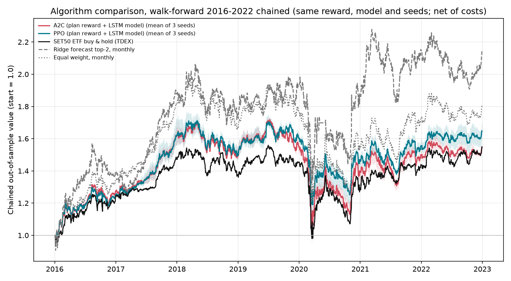

# DRL Algorithm Comparison (Milestone M6, RQ1/RQ4)

Date: 2026-11-07
Evidence tier: **exploratory**. Yahoo data, the five starter stocks, validation years only.
Outputs: `results/algorithm_comparison_20261106/` and `results/algorithm_comparison_combined_20261107/` (ignored by git)

> **Update 2026-11-25:** all five algorithms then ran on BistKA at 300k timesteps × 5 seeds ([report](bistka_300k_results_20261125.md)). A2C made 8.7% a year, PPO 4.4%, SAC 0.3%, TD3 −0.9% and DDPG −1.4%. The off-policy algorithms traded about 30 times their capital a year and are significantly worse than the benchmarks. PPO fell from 7.6% at 100k timesteps as it learned to hold cash. The 100k results below stand as the first, local comparison.

## Question

Which DRL algorithm works best, and most stably, under noisy Thai market data and limited compute (implementation plan RQ4)? Everything except the algorithm is fixed at the best design so far:

- the plan reward, weekly decisions, and the shared per-asset LSTM model;
- technical + SET50 market inputs and self-financing accounting at 0.20% cost per side;
- 100k timesteps per run;
- the seven walk-forward years (2016–2022) and seeds 42–44.

PPO is `plan_main_weekly_lstm` from the [seven-year walk-forward](walk_forward_reward_20261106.md) (same seeds), so it was reused rather than retrained. Config: `config/algorithm_comparison_experiment.yaml`.

## Status

| Algorithm | Family | Runs | Status |
| --- | --- | ---: | --- |
| PPO | on-policy | 21 | complete (reused) |
| A2C | on-policy | 21 | complete |
| SAC, TD3, DDPG | off-policy | 0 / 63 | stopped locally (see "Compute note"); **run on BistKA at 300k × 5 seeds, 2026-11-25** ([report](bistka_300k_results_20261125.md)) |

## Results: PPO vs A2C (7 validation years × 3 seeds each)

| Algorithm | Mean annual return | vs SET50 ETF | Years beating ETF | Worst year vs ETF | Mean max drawdown | Costs per year | Seed s.d. | Time per run (local) |
| --- | ---: | ---: | ---: | ---: | ---: | ---: | ---: | ---: |
| **PPO** | **8.2%** | **+1.1%** | **4/7** | −5.6% | **−11.1%** | 0.8% | 2.5% | ~10–20 min |
| A2C | 7.3% | +0.2% | 3/7 | −4.8% | −13.2% | 0.7% | 2.3% | ~3.7 min |
| SET50 ETF buy and hold | 7.1% | — | — | — | −11.3% | 0.0% | — | — |
| Equal weight, monthly | 10.1% | +3.0% | 4/7 | −4.0% | −13.9% | 0.3% | — | — |

Chained over 2016–2022, 1.00 grows to:

- **1.65 for PPO**
- 1.55 for A2C
- 1.55 for the SET50 ETF
- 1.80 for monthly equal weight



These are paired stationary-bootstrap Sharpe differences on chained daily returns (seed-mean curves):

| Comparison | Sharpe difference | 95% CI |
| --- | ---: | --- |
| A2C vs PPO | −0.11 | (−0.26, +0.04) |
| PPO vs SET50 ETF | +0.09 | (−0.25, +0.40) |
| A2C vs SET50 ETF | −0.02 | (−0.35, +0.27) |
| PPO vs equal weight | +0.01 | (−0.11, +0.13) |
| A2C vs equal weight | −0.10 | (−0.24, +0.05) |

## Findings

1. **PPO is the better on-policy choice, but not significantly.** It earned 0.9 points more a year than A2C, beat the ETF in one more year, and had a shallower drawdown. Most of the gap came after the 2020 crash, where PPO fell less. The Sharpe difference interval includes zero.
2. **A2C trains about 4× faster** at similar seed stability. If compute is the binding constraint, it is a reasonable fallback.
3. Neither algorithm beats equal weight of the same five stocks. That is the same survivorship-biased universe caveat as in the walk-forward report.

## Compute note: why the off-policy algorithms are not here

The off-policy runs were started with 7 parallel workers on this Mac and stopped after 2.5 hours with no run finished:

- **Memory.** Each worker's replay buffer held 100k observations of 2,406 numbers, stored twice: about 1.9 GB per process. Seven workers on an 8 GB machine drove swap to 12 of 13 GB.
- **Disk.** At the same time, iCloud was downloading the files that "Optimize Mac Storage" had evicted, saturating the disk (300–600 MB/s).

What changed:

- The runner now supports `optimize_memory_usage` and `replay_buffer_kwargs`, and the config stores each observation once (about 1 GB at 100k).
- A short SAC check confirmed it works (peak 0.58 GB after 3,000 steps).
- Even so, one SAC/TD3/DDPG run with the LSTM model takes about an hour on one core, so the 63 runs belong on BistKA:

```bash
export CONFIG=config/algorithm_comparison_experiment.yaml VARIANTS="algo_sac algo_td3 algo_ddpg"
export YEARS="2016 2017 2018 2019 2020 2021 2022" SEEDS="42 43 44" TIMESTEPS=100000 RUN_NAME=algorithm_comparison
sbatch --export=ALL --array=0-62%16 slurm/walk_forward_reward_array.sbatch
```

Then aggregate together with the local PPO and A2C runs:

```bash
python -m scripts.aggregate_walk_forward_reward --run-dir results/algorithm_comparison \
  --extra-run-dirs results/algorithm_comparison_20261106 results/walk_forward_reward_20261106 \
  --variants plan_main_weekly_lstm algo_a2c algo_sac algo_td3 algo_ddpg --seeds 42 43 44 --n-trials 5 \
  --output-dir results/algorithm_comparison_full
```
