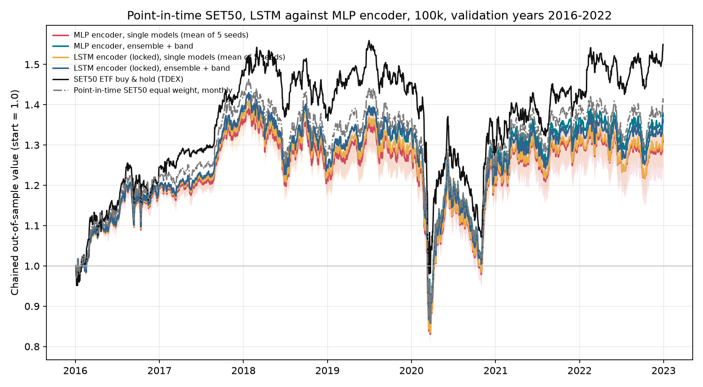

# Architecture Ablation: LSTM against MLP Encoder on the Point-in-Time SET50 (M5)

Date: 2026-11-27
Status: **done, validation years 2016–2022 only.** The locked design and its test-year and holdout results are unchanged; this is a check made after them, not a new selection.
Code: `temporal_encoder` in `src/models/feature_extractors.py` (commit `43f5bc4`); config `config/pit_architecture_ablation_cashcap.yaml`; pool `slurm/pools/local_20261126.tasks`.

## Summary

- **Question (M5 exit criterion):** does the recurrent encoder matter? The locked design reads each member's 30-session window, and the SET50 ETF's, with shared LSTMs. The new arm replaces both LSTMs with two-layer MLPs over the flattened window. Everything else is the same: inputs, shared weights across members, embedding size, fusion layers, shared-weight actor, 20% cash cap, 100k timesteps, seeds 42–46, folds 2016–2022.
- **Result: no measurable difference.** Single models: 4.4% a year with the MLP against 4.6% with the LSTM, Sharpe difference −0.006 (95% interval −0.040 to +0.022). Seed ensembles with the band: 5.1% against 5.0%, difference +0.012 (−0.027 to +0.043). Neither is significant.
- **Both still trail equal weight** (5.6% a year): the single models significantly (MLP −0.055, −0.109 to −0.017; LSTM −0.049, −0.093 to −0.018), the ensembles not significantly. The decision-7 scores are below zero for all four (best: the locked LSTM ensemble, −0.16 points a year; the MLP ensemble −0.29).
- **The MLP trades more:** 5.4 times its capital a year after entry against 3.3 for the LSTM's single models, so it pays 1.3 points a year in costs against 0.9. Its gross return is higher (5.7% against 5.4%), and the band removes most of the extra trading in the ensemble.
- **The MLP trains about 7 times faster:** 290 seconds a model against 1,960 on the Mac with three workers.
- **Reading:** on this universe the LSTM adds nothing over a plain window encoder. The five-stock comparison of 2026-11-06 ([report](long_term_reward_experiment_20261106.md); cumulative return over 2020–2022 with three seeds: fusion encoder +1.9% ± 1.1, flat MLP −8.8% ± 17.2) set the fusion design against SB3's flat MLP over the whole observation. That flat MLP had no per-member weight sharing, and its seeds disagreed widely. The gap there more likely came from the shared per-member structure than from recurrence, though this run tests only the larger universe and the shared-weight actor.

## Results (validation years 2016–2022, 100k timesteps, 5 seeds, 0.20% cost per side)

| Policy | 2016 | 2017 | 2018 | 2019 | 2020 | 2021 | 2022 | Mean a year | Chained | Sharpe |
| --- | ---: | ---: | ---: | ---: | ---: | ---: | ---: | ---: | ---: | ---: |
| MLP encoder, single models (mean of 5 seeds) | 19.3% | 13.6% | −10.2% | 5.7% | −6.8% | 9.7% | −0.6% | 4.4% | 1.308 | 0.33 |
| LSTM encoder (locked), single models | 19.6% | 14.8% | −10.3% | 6.0% | −7.5% | 9.6% | −0.2% | 4.6% | 1.319 | 0.33 |
| MLP encoder, ensemble + band | 20.0% | 14.7% | −9.2% | 7.0% | −7.4% | 10.3% | 0.4% | 5.1% | 1.372 | 0.37 |
| LSTM encoder (locked), ensemble + band | 19.9% | 15.8% | −10.0% | 7.4% | −8.7% | 10.0% | 0.7% | 5.0% | 1.357 | 0.36 |
| Equal weight, monthly | 22.2% | 16.5% | −10.0% | 6.5% | −8.5% | 11.9% | 0.7% | 5.6% | 1.407 | 0.38 |
| SET50 ETF, buy and hold | 24.5% | 18.2% | −6.5% | 5.7% | −11.8% | 12.1% | 7.8% | 7.1% | 1.549 | 0.50 |

| | MLP, single | LSTM, single | MLP, ensemble + band | LSTM, ensemble + band | Equal weight |
| --- | ---: | ---: | ---: | ---: | ---: |
| Gross return a year | 5.7% | 5.4% | 5.5% | 5.3% | 6.0% |
| Cost drag a year | 1.3 pts | 0.9 pts | 0.4 pts | 0.3 pts | 0.4 pts |
| Turnover a year after entry | 5.4× | 3.3× | 1.1× | 0.6× | 0.9× |
| Average cash | 6.4% | 5.1% | 6.5% | 5.4% | 0.7% |
| Seed spread (std of a fold's return) | 1.09 pts | 0.93 pts | | | |
| Decision-7 score (points a year) | −1.35 | −0.96 | −0.29 | −0.16 | 0 |
| Folds ahead of equal weight | 1 | 1 | 3 | 1 | |

Sharpe differences (block bootstrap, 1,699 daily returns; deflated Sharpe ratios counted over 26 designs):

| Comparison | Difference | 95% interval | Significant |
| --- | ---: | --- | --- |
| MLP single − LSTM single | −0.006 | −0.040 to +0.022 | no |
| MLP ensemble − LSTM ensemble | +0.012 | −0.027 to +0.043 | no |
| MLP single − equal weight | −0.055 | −0.109 to −0.017 | yes (worse) |
| LSTM single − equal weight | −0.049 | −0.093 to −0.018 | yes (worse) |
| MLP ensemble − equal weight | −0.010 | −0.045 to +0.020 | no |
| LSTM ensemble − equal weight | −0.022 | −0.054 to +0.016 | no |
| MLP ensemble − ETF | −0.128 | −0.382 to +0.096 | no |

Cash: five of the 35 MLP models averaged more than 15% cash over their year (three LSTM models); none exceeded the 20% cap by more than rounding (maximum 20.1%). The ensemble's replay check matched every seed's saved curve to within 2.2 × 10⁻¹⁶.



## The encoder

`temporal_encoder: mlp` encodes a member's window (30 sessions × 12 stock inputs, flattened to 360 numbers) with `Linear(360, 32) → ReLU → Linear(32, 32) → Tanh`. The market window (30 × 5) gets its own MLP of the same shape. The tanh output keeps the embedding in the LSTM hidden state's range. The weights are shared across members, so the shared-weight actor still does not depend on the slot order (tested). `lstm` stays the default and builds exactly the modules it built before. A 1,024-step run of the locked design gave byte-identical curves and holdings before and after the change, and saved models load unchanged.

## Compute and one task rerun

- **Mac, three workers, 2026-11-26 23:16 to 2026-11-27 00:16:** 35 models, about 290 seconds each (the locked LSTM design: about 1,960 seconds).
- **One rerun:** fold 2021, seed 43 printed its results and wrote every file, but its process then exited with a non-zero status, so the pool marked it `FAILED`. The folder was set aside (`~/drl_runs/arch_mlp_aside_20261127/`) and the task retrained. The rerun's curve and holdings are byte-identical to the set-aside copy (`scripts/compare_model_runs.py`: zero gap on every session), so the exit came after the work was done.

## Files

- `~/drl_runs/pit_walk_forward_arch_mlp_cashcap_20261126/`: the 35 models, one folder per fold and seed, with logs.
- `~/drl_runs/pit_arch_mlp_ensemble_20261126/`: the seed ensemble with the band, its replay check and diagnostics.
- `~/drl_runs/pit_walk_forward_combined_arch_mlp_20261126/`: summary, fold returns, metrics, significance against equal weight, the ETF and both LSTM designs, diagnostics, figure, and `decision7/`.
- `config/arch_mlp_candidates_20261127.yaml`: decision-7 inputs.

## Commands

```bash
R=~/drl_runs; V=pit_plan_weekly_lstm_shared_cashcap; M=pit_cashcap_arch_mlp
S=$R/pit_walk_forward_arch_mlp_cashcap_20261126; E=$R/pit_arch_mlp_ensemble_20261126
O=$R/pit_walk_forward_combined_arch_mlp_20261126
PYTHON=~/.venvs/drl_thai_py311/bin/python bash scripts/run_task_pool.sh slurm/pools/local_20261126.tasks 3
python -m scripts.evaluate_pit_seed_ensemble --config config/pit_architecture_ablation_cashcap.yaml \
  --source-run $S --variant $M --seeds 42 43 44 45 46 --output-dir $E --band 0.005 --modes ensemble_band
python -m scripts.aggregate_walk_forward_reward --run-dir $S \
  --extra-run-dirs $E $R/pit_walk_forward_cash_cap_100k_5seeds_20261125 $R/pit_cash_cap_ensemble_100k_5seeds_20261125 \
  --variants $M $V --seeds 42 43 44 45 46 --n-trials 26 --output-dir $O \
  --references pit_equal_weight_monthly ${V}_ensemble_band $V \
  --title "Point-in-time SET50, LSTM against MLP encoder, 100k, validation years 2016-2022" \
  --labels "$M=MLP encoder, single models" "${M}_ensemble_band=MLP encoder, ensemble + band" \
  "$V=LSTM encoder (locked), single models" "${V}_ensemble_band=LSTM encoder (locked), ensemble + band"
python -m scripts.walk_forward_agent_diagnostics --run-dir $E --variant ${M}_ensemble_band --prefix diagnostics_ensemble_band
python -m scripts.walk_forward_agent_diagnostics --run-dir $S --variant $M --output-dir $O --prefix diagnostics_single
python -m scripts.rank_final_candidates --candidates config/arch_mlp_candidates_20261127.yaml --base $R --output-dir $O/decision7
```
