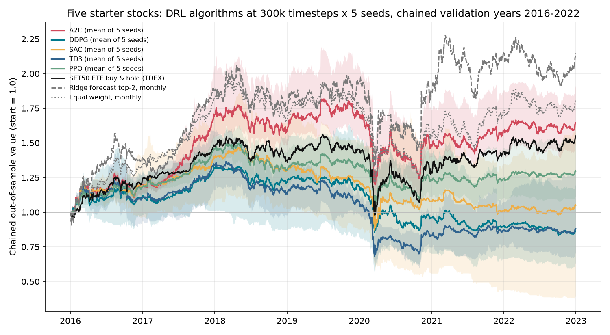
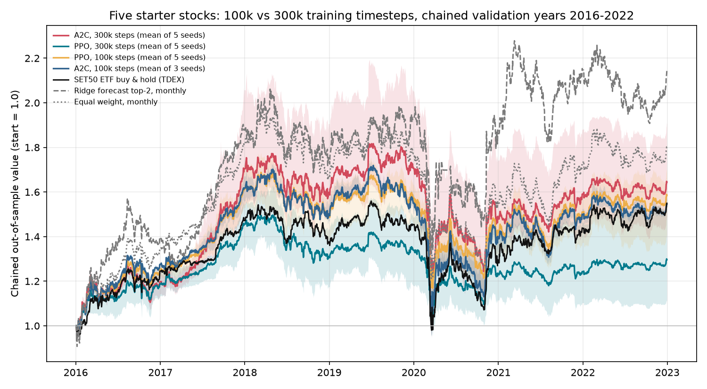
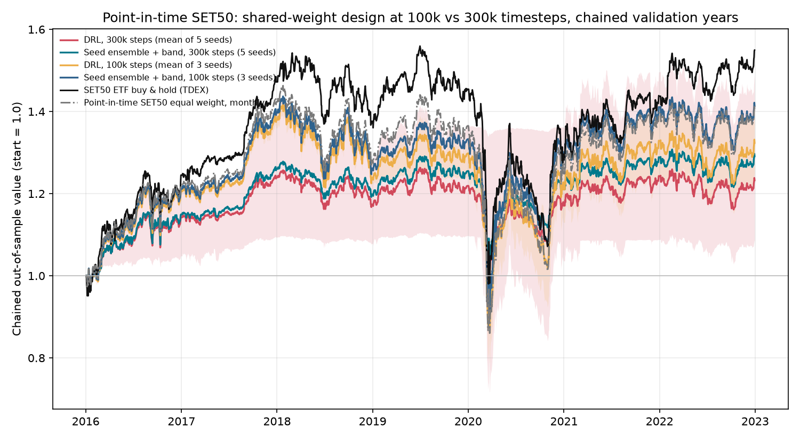

# Longer Training on BistKA: Five Algorithms and the Point-in-Time Design at 300k Timesteps (M6, RQ4/RQ6)

Date: 2026-11-25
Evidence tier: **exploratory**. Yahoo data, validation years 2016–2022 only; the 2023–2024 test years and the sealed 2025+ holdout were not read.
Job: BistKA `4409` (one 32-CPU pool job, 56.0 hours, about 2,465 SHr; [HPC record](../hpc/hpc_sync_status.md)).
Outputs (git-ignored): `results/algorithm_comparison_bistka_20261122/`, `results/walk_forward_reward_bistka_20261122/`, `results/pit_walk_forward_bistka_20261122/` (training), and `results/algorithm_comparison_bistka_combined_20261125/`, `results/algorithm_budget_combined_20261125/`, `results/pit_seed_ensemble_bistka_20261125/`, `results/pit_walk_forward_combined_bistka_20261125/` (analysis).

## What was run

Every model trained for **300k timesteps** (three times the earlier local runs), with **five seeds** (42–46), on the seven walk-forward folds (each validation year 2016–2022 trained only on earlier years). 210 models in all:

- **Five starter stocks, all five algorithms (RQ4):** PPO (`plan_main_weekly_lstm`), A2C, SAC, TD3 and DDPG. Everything except the algorithm is the earlier comparison's fixed design: the plan reward, weekly decisions, the per-asset LSTM model, technical + SET50 market inputs, 0.20% cost per side ([earlier report](algorithm_comparison_20261107.md); `config/algorithm_comparison_experiment.yaml`).
- **Point-in-time SET50:** the shared-weight design `pit_plan_weekly_lstm_shared` ([report](pit_walk_forward_20261107.md); `config/pit_walk_forward_experiment.yaml`), and its seed ensemble with the 0.5-point no-trade band at evaluation, now over five seeds.

The statistics are as before: Sharpe ratios on 1,699 chained daily validation returns (the seed-mean curve per design), paired stationary bootstrap, 95% intervals. "Significant" means the interval excludes zero. The 100k runs are the earlier local runs, set beside these with the aggregator's new `--rename` option, so both are tested on the same sessions.

**Deflated Sharpe counts:**
- **Five starter stocks:** 14 designs (6 in the reward experiment, 2 in the source ablation, A2C at 100k, and the five algorithms here).
- **Point-in-time SET50:** 21 designs (the 19 before, plus the 300k single models and their ensemble with the band).

## Five starter stocks: the algorithm comparison at 300k

| Algorithm | Mean annual return | vs SET50 ETF | Years beating the ETF | Worst year vs ETF | Mean max drawdown | Cost drag a year | Turnover a year | Average cash | Seed s.d. | Training per model (BistKA) |
| --- | ---: | ---: | ---: | ---: | ---: | ---: | ---: | ---: | ---: | ---: |
| **A2C** | **8.7%** | **+1.5** | 3/7 | −4.7 | −13.1% | 0.9 | 4.3× | 15% | 5.9 | 0.4 h |
| PPO | 4.4% | −2.8 | 2/7 | −11.1 | **−9.8%** | 1.3 | 6.0× | 39% | 4.2 | 1.1 h |
| SAC | 0.3% | −6.8 | 0/7 | −19.5 | −15.8% | 6.1 | 29.4× | 44% | 11.0 | 17.2 h |
| TD3 | −0.9% | −8.0 | 1/7 | −13.6 | −17.5% | 6.6 | 32.1× | 30% | 8.5 | 10.7 h |
| DDPG | −1.4% | −8.6 | 0/7 | −17.5 | −16.5% | 6.3 | 30.5× | 38% | 9.8 | 13.9 h |
| SET50 ETF buy and hold | 7.1% | — | — | — | −11.2% | 0.0 | — | — | — | — |
| Equal weight, monthly | 10.1% | +3.0 | 4/7 | −4.0 | −13.9% | 0.3 | 1.4× | 0% | — | — |
| Ridge forecast, top two monthly | 12.8% | +5.6 | 5/7 | −7.8 | −16.8% | — | — | — | — | — |

Differences from the ETF and seed standard deviations are in percentage points of annual return. Chained over 2016–2022, 1.00 grew to 1.65 for A2C, 1.30 for PPO, 1.05 for SAC, 0.88 for TD3 and 0.86 for DDPG; the ETF reached 1.55, equal weight 1.80 and the ridge forecaster 2.15.



| Comparison | Sharpe difference | 95% interval |
| --- | ---: | --- |
| A2C − ETF | +0.03 | −0.36 to +0.37 |
| A2C − equal weight | −0.05 | −0.29 to +0.20 |
| A2C − PPO | +0.14 | −0.04 to +0.34 |
| PPO − equal weight | −0.19 | −0.42 to +0.03 |
| SAC − equal weight | **−0.46** | −0.90 to −0.05 |
| SAC − ETF | −0.38 | −0.89 to +0.09 |
| TD3 − ETF | **−0.53** | −0.93 to −0.15 |
| DDPG − ETF | **−0.59** | −1.11 to −0.14 |
| TD3 − PPO | **−0.42** | −0.67 to −0.16 |
| DDPG − PPO | **−0.48** | −0.79 to −0.19 |

- **Sharpe ratios:** A2C 0.53, PPO 0.39, SAC 0.12, TD3 −0.03, DDPG −0.09; the ETF 0.50, equal weight 0.58, the ridge forecaster 0.62.
- **Deflated Sharpe (14 designs):** A2C 0.35, PPO 0.23, SAC 0.08, TD3 0.03, DDPG 0.03.

**Findings:**
1. **The off-policy algorithms lose, mainly through trading.** SAC, TD3 and DDPG turned over about 30 times their capital a year, against 4–6 times for A2C and PPO, and paid 6.1–6.6 points a year in costs. Before costs they made 4.9–6.4% a year, still about 4–6 points less than equal weight. TD3 and DDPG are significantly worse than the ETF, equal weight and PPO; SAC is significantly worse than equal weight. Their seeds disagree most (seed s.d. 8.5–11.0 points; one SAC seed ended at 0.39). They used the config's fixed settings (replay from 2,000 steps, batch 256) without tuning, and nothing in their reward or environment limits weekly weight changes.
2. **A2C is the best DRL algorithm here, but not significantly.** It made 8.7% a year, 1.5 points above the ETF, with 0.4 hours of training per model. Its Sharpe ratio is not significantly different from the ETF's, equal weight's or PPO's. Its seeds spread widely (5.9 points), and much of its lead comes from 2017 (+42% against +18% for the ETF).
3. **PPO fell from first to second**, because it trained longer (next section).
4. **Compute:** SAC needed 17 hours per model, against 0.4 hours for A2C and 1.1 hours for PPO: about 45 times A2C's compute, for a far worse result.

## More training is not better: 100k against 300k timesteps

| Design | Timesteps | Seeds | Mean annual return | Return before costs | Average cash | Mean max drawdown | Sharpe | Sharpe difference, 300k − 100k (95% interval) |
| --- | ---: | ---: | ---: | ---: | ---: | ---: | ---: | --- |
| PPO, five stocks | 100k | 5 | 7.7% | 8.5% | 20% | −11.1% | 0.55 | |
| PPO, five stocks | 300k | 5 | 4.4% | 5.7% | 39% | −9.8% | 0.39 | **−0.16 (−0.33 to −0.01)** |
| A2C, five stocks | 100k | 3 | 7.3% | 8.0% | 16% | −13.2% | 0.48 | |
| A2C, five stocks | 300k | 5 | 8.7% | 9.6% | 15% | −13.1% | 0.53 | +0.05 (−0.19 to +0.28) |
| Point-in-time, single models | 100k | 3 | 4.6% | 5.5% | 11% | −11.7% | 0.35 | |
| Point-in-time, single models | 300k | 5 | 3.2% | 3.9% | 41% | −7.2% | 0.39 | +0.04 (−0.13 to +0.20) |
| Point-in-time, seed ensemble + band | 100k | 3 | 5.5% | 5.9% | 10% | −11.3% | 0.42 | |
| Point-in-time, seed ensemble + band | 300k | 5 | 3.9% | 4.1% | 41% | −7.0% | 0.48 | +0.06 (−0.11 to +0.21) |



- **PPO learned to hold cash.** On five stocks, with the same five seeds, its average cash doubled from 20% to 39%. Its return fell in 6 of 7 years, and its Sharpe ratio fell significantly. This is the only significant budget effect.
- **So did the point-in-time agent.**
  - **Cash:** at 300k, 17 of its 35 models held 45–98% cash on average over their year, and 15 held under 5%. At 100k, 2 of 21 models held that much.
  - **A fixed level:** a cash-heavy model's cash moved little within its year (median standard deviation 1.4 points), so it is a fixed level each model learned, not a response to the market. This is what the attribution found for the 100k cash-heavy models ([report](pit_walk_forward_20261107.md#follow-up-cash-capped-at-20-2026-11-19)).
  - **The stocks themselves:** the stock part of the portfolio stayed close to equal weight (daily correlation 0.998 for the ensemble, 43.7 effective holdings).
- **Lower return, lower risk, about the same Sharpe ratio.**
  - **Return:** the point-in-time ensemble with the band made 3.9% a year at 300k, against 5.5% at 100k, and fell 7.0% at worst in a year on average, against 11.3%.
  - **Risk-adjusted:** its Sharpe ratio was 0.48, against 0.42; the difference is not significant.
  - **By year:** it lost less than equal weight in the two falling years, 2018 (−4.9% against −10.0%) and 2020 (−3.6% against −8.5%), and trailed it in the other five.
  - **Chained:** 1 baht became 1.29, against 1.41 for the 100k ensemble and for equal weight, and 1.55 for the ETF.
- **A2C did not drift to cash** (15% against 16%) and made 1.4 points a year more, with much wider seed spread (5.9 against 2.3 points). Its gain is not significant.



**Point-in-time significance at 300k:**

| Comparison | Sharpe difference | 95% interval |
| --- | ---: | --- |
| Seed ensemble + band − its seeds | **+0.08** | +0.05 to +0.12 |
| Seed ensemble + band − point-in-time equal weight | +0.09 | −0.12 to +0.27 |
| Seed ensemble + band − ETF | −0.02 | −0.35 to +0.23 |
| Single models − point-in-time equal weight | +0.01 | −0.20 to +0.18 |

- **Deflated Sharpe (21 designs):** 0.25 for the 300k ensemble with the band, 0.19 for its seeds, 0.20 for the 100k ensemble with the band (0.22 at 19 designs), 0.18 for equal weight and 0.27 for the ETF.
- **The ensemble still helps:** it beats the mean of its own seeds significantly, as at 100k.

**Why the cash grows with training is not tested here.** One reading: the plan reward subtracts half of each new drawdown, so cash lowers the penalty, and a longer-trained policy settles further into that. If so, a training budget picked on validation years is itself a design choice, and counts in the deflated Sharpe.

## What it means

- **RQ4 (algorithm):** on the five starter stocks with this design, the on-policy algorithms are clearly better than the off-policy ones, which overtrade. A2C is the best and cheapest, but no algorithm is significantly better than the ETF or equal weight.
- **RQ1 (profitability):** more training did not lift the DRL agents above the simple benchmarks. By return, the best point-in-time design is still the 100k seed ensemble with the band (5.5% a year). By Sharpe ratio, the 300k ensemble with the band is level with the ETF (0.48 against 0.50) with a smaller drawdown, but it earns less, because 41% of it sat in cash.
- **Training budget:** the M6 target of at least 200k timesteps and five seeds is met for these designs. Beyond 100k, longer training mainly raised cash, so the training budget has to be chosen and justified, not simply maximized.

## Compute (RQ6)

- **One pool job:** 210 models, 1,776 task-hours of training, in 56.0 hours of wall time on 32 hyperthreads (16 physical cores): about 32 times faster than one worker.
- **Cost:** about 2,465 SHr, at 44 SHr an hour; 12.8 of those 44 come from the 128 GB memory request, when the job used at most 49 GB. A 64 GB request would have cost about 2,150 SHr. About 7,500 of the project's 10,000 SHr remain.
- **Per model:** a point-in-time model trained at about 11 timesteps a second per worker, against about 25 on one core of the development Mac. Two workers shared each physical core.
- **Measured without disturbing the job:** `hpc/buffer_rate.py` (off-policy replay buffers) and `hpc/rollout_period.py` (PPO iterations) gave each algorithm's speed while it ran, and the end-time projection.

## Run it

Training (BistKA, one job; [HPC record](../hpc/hpc_sync_status.md)):

```bash
cd /lustrefs/project/25sfcs03/drl_thai_stock_20261122 && mkdir -p logs
sbatch --export=ALL,PROJECT_DIR=$PWD,POOL=slurm/pools/bistka_20261122.tasks slurm/walk_forward_pool.sbatch
```

Analysis (local, about five minutes; `~/drl_runs` holds the run folders, `$P` the project's `results/` with the earlier 100k runs):

```bash
R=~/drl_runs
python -m scripts.aggregate_walk_forward_reward --run-dir $R/algorithm_comparison_bistka_20261122 \
  --extra-run-dirs $R/walk_forward_reward_bistka_20261122 \
  --variants plan_main_weekly_lstm algo_a2c algo_sac algo_td3 algo_ddpg --seeds 42 43 44 45 46 --n-trials 14 \
  --output-dir $R/algorithm_comparison_bistka_combined_20261125 --references plan_main_weekly_lstm \
  --labels plan_main_weekly_lstm="PPO" algo_a2c="A2C" algo_sac="SAC" algo_td3="TD3" algo_ddpg="DDPG"
for v in algo_sac algo_td3 algo_ddpg algo_a2c; do
  python -m scripts.walk_forward_agent_diagnostics --run-dir $R/algorithm_comparison_bistka_20261122 --variant $v \
    --reference equal_weight_monthly --rebalance-every 5 --reference-rebalance-every 21 \
    --output-dir $R/algorithm_comparison_bistka_combined_20261125 --prefix diagnostics_$v
done
python -m scripts.walk_forward_agent_diagnostics --run-dir $R/walk_forward_reward_bistka_20261122 --variant plan_main_weekly_lstm \
  --reference equal_weight_monthly --rebalance-every 5 --reference-rebalance-every 21 \
  --output-dir $R/algorithm_comparison_bistka_combined_20261125 --prefix diagnostics_plan_main_weekly_lstm

python -m scripts.aggregate_walk_forward_reward --run-dir $R/algorithm_comparison_bistka_20261122 \
  --extra-run-dirs $R/walk_forward_reward_bistka_20261122 $P/walk_forward_reward_20261106 $R/algorithm_comparison_20261106 \
  --rename $P/walk_forward_reward_20261106:plan_main_weekly_lstm=plan_main_weekly_lstm_100k \
  $R/algorithm_comparison_20261106:algo_a2c=algo_a2c_100k \
  --variants plan_main_weekly_lstm plan_main_weekly_lstm_100k algo_a2c algo_a2c_100k --n-trials 14 \
  --output-dir $R/algorithm_budget_combined_20261125 --references plan_main_weekly_lstm_100k algo_a2c_100k plan_main_weekly_lstm

python -m scripts.evaluate_pit_seed_ensemble --config config/pit_walk_forward_experiment.yaml \
  --source-run $R/pit_walk_forward_bistka_20261122 --variant pit_plan_weekly_lstm_shared --seeds 42 43 44 45 46 \
  --output-dir $R/pit_seed_ensemble_bistka_20261125 --band 0.005 --modes ensemble_band
python -m scripts.aggregate_walk_forward_reward --run-dir $R/pit_walk_forward_bistka_20261122 \
  --extra-run-dirs $R/pit_seed_ensemble_bistka_20261125 $R/pit_walk_forward_shared_20261110 $R/pit_seed_ensemble_20261110 \
  --rename $R/pit_walk_forward_shared_20261110:pit_plan_weekly_lstm_shared=pit_plan_weekly_lstm_shared_100k \
  $R/pit_seed_ensemble_20261110:pit_plan_weekly_lstm_shared_ensemble_band=pit_plan_weekly_lstm_shared_ensemble_band_100k \
  --variants pit_plan_weekly_lstm_shared pit_plan_weekly_lstm_shared_100k --drop pit_plan_weekly_lstm_shared_ensemble \
  --n-trials 21 --output-dir $R/pit_walk_forward_combined_bistka_20261125 \
  --references pit_plan_weekly_lstm_shared pit_plan_weekly_lstm_shared_100k pit_plan_weekly_lstm_shared_ensemble_band \
  pit_plan_weekly_lstm_shared_ensemble_band_100k
python -m scripts.walk_forward_agent_diagnostics --run-dir $R/pit_walk_forward_bistka_20261122 \
  --variant pit_plan_weekly_lstm_shared --pit-config config/pit_walk_forward_experiment.yaml
python -m scripts.walk_forward_agent_diagnostics --run-dir $R/pit_seed_ensemble_bistka_20261125 \
  --variant pit_plan_weekly_lstm_shared_ensemble_band --prefix diagnostics_ensemble_band
```

The ensemble evaluation needs the 35 point-in-time model files (16 MB), copied from BistKA. Before evaluating, it replayed every model on the Mac (torch 2.15, SB3 2.9.2, pandas 2.3, against BistKA's torch 2.10, SB3 2.8.0, pandas 3.0); the largest gap from BistKA's saved curves was 6 × 10⁻⁹ of the portfolio value.
