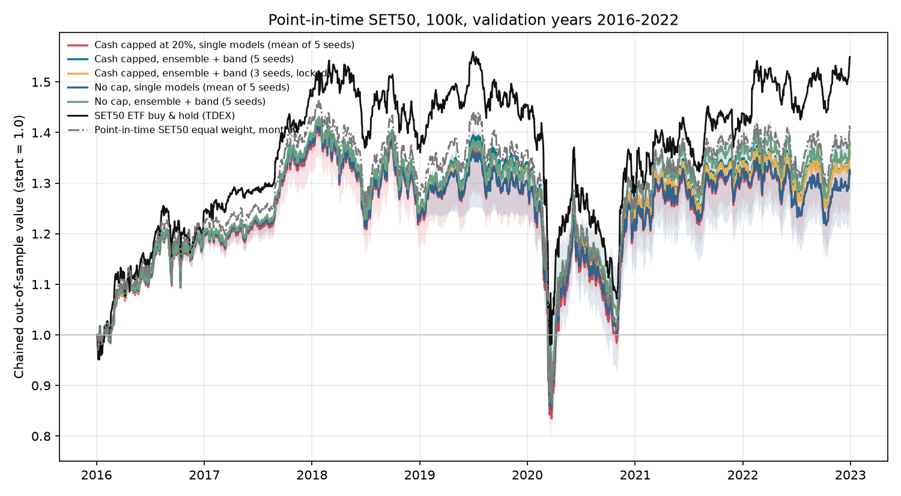
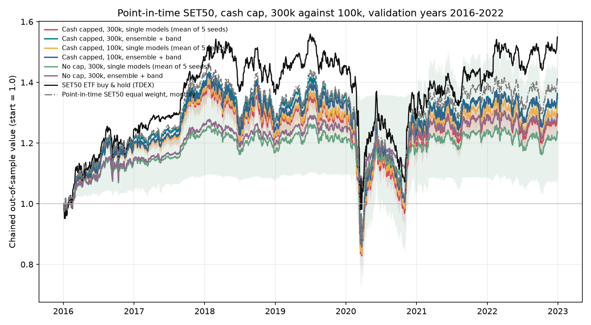

# The Locked Design With Five Seeds, and at 300k Timesteps (M6, RQ6; validation years only)

Date: 2026-11-26
Evidence tier: **exploratory**. Yahoo data, validation years 2016–2022 only. The test years 2023–2024 were not read again, and the sealed 2025+ holdout was not read at all. Nothing here changes the locked design or the test results already recorded ([test report](final_test_results_20261125.md)).
Outputs (git-ignored): `results/pit_walk_forward_cash_cap_100k_s4546_20261125/` and `results/pit_walk_forward_cash_cap_bistka_20261125/` (training), `results/pit_cash_cap_ensemble_100k_5seeds_20261125/`, `results/pit_walk_forward_combined_cash_cap_5seeds_20261125/`, `results/pit_cash_cap_ensemble_bistka_20261126/` and `results/pit_walk_forward_combined_cash_cap_bistka_20261126/` (analysis).
Job: BistKA `4518` (one 32-CPU pool job, 11.2 hours, 450 SHr; [HPC record](../hpc/hpc_sync_status.md)).

## Why

The design locked for the test is the shared-weight point-in-time actor with cash capped at 20%, as a seed ensemble with the 0.5-point no-trade band ([decision](final_design_decision_20261125.md)). It was chosen with three seeds (42–44) at 100k timesteps. Two questions were left open:

1. **Does the choice hold with five seeds?** The uncapped design already has five seeds at 100k ([report](bistka_300k_results_20261125.md)).
2. **Does longer training help once the cap blocks the drift to cash?** Without the cap, 300k timesteps pushed 17 of 35 models to 45–98% cash and lowered the return. BistKA job `4518` trains the capped design at 300k with five seeds (section below).

## Five seeds at 100k

Seeds 45 and 46 were trained on the Mac: 14 models, 3 workers, from 22:10 on 2026-11-25 to 00:23 on 2026-11-26 (`slurm/pools/local_20261125b.tasks`). No errors. The folder `pit_walk_forward_cash_cap_100k_5seeds_20261125` links seeds 42–44 (2026-11-19) and 45–46, so the ensemble reads all five from one place. Every model replayed its saved validation curve to within 2.2 × 10⁻¹⁶.

| Design (100k, validation 2016–2022) | Seeds | Mean annual return | Average cash | Mean max drawdown | Sharpe | 1 baht became | Decision-7 score | Years ahead of equal weight |
| --- | ---: | ---: | ---: | ---: | ---: | ---: | ---: | ---: |
| **Cash capped, ensemble + band (locked)** | **3** | **5.0%** | **7.6%** | **−12.0%** | **0.36** | **1.36** | **−0.01** | **3/7** |
| Cash capped, ensemble + band | 5 | 5.0% | 5.4% | −12.2% | 0.36 | 1.36 | −0.16 | 1/7 |
| Cash capped, single models | 5 | 4.6% | 5.1% | −12.5% | 0.33 | 1.32 | −0.96 | 1/7 |
| No cap, ensemble + band | 5 | 5.2% | 6.9% | −12.0% | 0.38 | 1.38 | −0.78 | 2/7 |
| No cap, single models | 5 | 4.5% | 7.2% | −12.2% | 0.34 | 1.32 | −1.45 | 1/7 |
| Point-in-time equal weight, monthly | | 5.6% | 0.7% | −12.7% | 0.38 | 1.41 | 0 | |
| SET50 ETF, buy and hold | | 7.1% | | −11.2% | 0.50 | 1.55 | | |

The decision-7 score is the median over years of the annualized log return above point-in-time equal weight, in points a year, after averaging the seeds (the rule in the [decision](final_design_decision_20261125.md)). The single models' chained value is the mean of their seed curves.



- **The locked choice holds up.** With five seeds, the capped ensemble is still the best-scoring DRL design at 100k (−0.16 points a year, against −0.78 without the cap). It still scores below zero, so the rule's fallback to equal weight is unchanged.
- **Two more seeds moved the score, not the result.** The ensemble's return (5.0%), Sharpe ratio (0.36) and chained value (1.36) are the same with three or five seeds. The two Sharpe ratios differ by −0.004 (−0.023 to +0.015). Its median moved from −0.01 to −0.16 because two years near zero, 2020 and 2022, turned slightly negative. Its mean barely moved (−0.56 to −0.54).
- **At 100k the cap barely binds.** Average cash was 5% with the cap and 7% without it. Only 3 of the 35 capped models held more than 15% on average, all seed 43 (2017, 2019, 2020), at about the 20% cap. Without the cap, 2 of 35 held more than 45%. Capped against uncapped ensemble: Sharpe −0.02 (−0.06 to +0.04), not significant.
- **Nothing beats the benchmarks significantly.**
  - Capped ensemble against equal weight: −0.02 (−0.05 to +0.02).
  - Capped ensemble against the ETF: −0.14 (−0.39 to +0.10).
  - Deflated Sharpe at 22 designs: 0.16 for the capped ensemble (five or three seeds), 0.17 for equal weight, 0.26 for the ETF.
- **The ensemble's gain over its own seeds is borderline with the cap.**
  - Capped ensemble against its five seeds: +0.03 (−0.001 to +0.06), not quite significant.
  - Uncapped ensemble against its seeds: +0.04 (+0.02 to +0.06), significant.
  - The cap already removes part of what the ensemble averaged away: the cash-heavy seeds.

**For the test results:** the test used the locked three-seed ensemble, and that does not change. The five-seed result says that choice was not an accident of three seeds. On validation, the five-seed ensemble earns the same and ranks the same.

## 300k timesteps (BistKA job 4518)

BistKA job `4518` trained the capped design at 300k timesteps: seeds 42–46 on the same seven folds, 35 models, validation years only. It ran from 22:09 on 2026-11-25 to 09:23 on 2026-11-26 (11.2 hours) with no errors, and billed 450 SHr (32 CPUs and 80 GB at 40 SHr an hour), leaving 7,064 of the project's 10,000. The curves and the 35 model files (16 MB) were copied to the Mac; a checksum pass finds no difference. Every model replays BistKA's saved curve on the Mac to within 1.0 × 10⁻⁸ of the portfolio value.

| Design (five seeds, validation 2016–2022) | Timesteps | Mean annual return | Return before costs | Average cash | Models at the 20% cap | Mean max drawdown | Sharpe | 1 baht became | Decision-7 score |
| --- | ---: | ---: | ---: | ---: | ---: | ---: | ---: | ---: | ---: |
| Cash capped, ensemble + band | 100k | 5.0% | 5.3% | 5.4% | | −12.2% | 0.36 | 1.36 | −0.16 |
| **Cash capped, ensemble + band** | **300k** | **4.9%** | **5.2%** | **8.8%** | | **−12.0%** | **0.35** | **1.35** | **−0.64** |
| Cash capped, single models | 100k | 4.6% | 5.4% | 5.1% | 3 of 35 | −12.5% | 0.33 | 1.32 | −0.96 |
| Cash capped, single models | 300k | 4.2% | 5.2% | 8.7% | 10 of 35 | −12.1% | 0.31 | 1.29 | −1.28 |
| No cap, ensemble + band | 300k | 3.9% | 4.1% | 41% | | −7.0% | 0.47 | 1.29 | −1.78 |
| No cap, single models | 300k | 3.2% | 3.9% | 41% | | −7.2% | 0.39 | 1.23 | −2.74 |
| Point-in-time equal weight, monthly | | 5.6% | 6.0% | 0.7% | | −12.7% | 0.38 | 1.41 | 0 |
| SET50 ETF, buy and hold | | 7.1% | | | | −11.2% | 0.50 | 1.55 | |

"At the cap" means a model whose average cash over its year was 19% or more. The uncapped rows are from the [300k report](bistka_300k_results_20261125.md).



- **The cap did its job.** Without it, 300k training put 17 of 35 models at 45–98% cash and the average at 41%. With it, average cash was 8.7%. The capped ensemble made 4.9% a year at 300k, against 3.9% for the uncapped one.
- **The pull towards cash is still there.** 10 of the 35 capped models held 19% or more cash on average over their year, close to the 20% cap, against 3 at 100k. 18 held under 5%. Longer training still teaches some seeds to hold as much cash as they are allowed. The cap contains this; it does not remove it.
- **More training did not help.**
  - The capped ensemble earned 4.9% at 300k against 5.0% at 100k. Its Sharpe ratio was 0.35 against 0.36, a difference of −0.004 (−0.044 to +0.041).
  - The single models fell from 4.6% to 4.2%, a Sharpe difference of −0.02 (−0.06 to +0.02).
  - Neither difference is significant. Before costs the 300k models earned slightly less (5.2% against 5.4%), and the single models traded more (5.2× against 4.2× a year), so costs took 1.1 points a year against 0.9.
- **The decision-7 score fell** from −0.16 to −0.64 for the ensemble and from −0.96 to −1.28 for the single models. The capped 300k ensemble beat equal weight only in 2018 (−8.6% against −10.0%).
- **Against the benchmarks:**
  - Capped ensemble against equal weight: −0.03 (−0.07 to +0.02), not significant.
  - Capped single models against equal weight: −0.07 (−0.12 to −0.03), significantly worse.
  - Capped ensemble against the ETF: −0.14 (−0.39 to +0.08), not significant.
  - Capped ensemble against the uncapped 300k ensemble: −0.12 (−0.31 to +0.10), not significant. The uncapped one has the higher Sharpe ratio because 41% cash lowered its risk more than its return.
  - Deflated Sharpe at 24 designs (the 22 before, plus the capped single models and ensemble at 300k): 0.15 for the capped ensemble at either budget, 0.17 for equal weight, 0.23 for the uncapped 300k ensemble and 0.25 for the ETF.
- **The ensemble beats its own seeds significantly at 300k:** +0.04 (+0.01 to +0.09), as without the cap. At 100k the same gain was borderline.

**Training budget (M6, RQ6):** for this design, 100k timesteps is enough. Three times the training changed nothing significant. The cap removed the large loss that longer training caused without it, but not the tendency behind it.

**Compute:** with 32 models at once on 32 hyperthreads (16 cores), each model took 8.9 hours. The last three, with the other 29 CPUs idle, took 2.3 hours each. So a model trains about four times faster without contention, but 32 at once still finish more models per hour (3.6 against 1.3).

**For the test results:** nothing changes. The locked design is the 100k three-seed ensemble, and on validation it is level with the 300k version.

## Run it

```bash
R=~/drl_runs
# Training (local, 3 workers; 14 tasks, about 2.5 hours)
PYTHON=~/.venvs/drl_thai_py311/bin/python bash scripts/run_task_pool.sh slurm/pools/local_20261125b.tasks 3
# One folder with all five seeds (links)
V=pit_plan_weekly_lstm_shared_cashcap; S=$R/pit_walk_forward_cash_cap_100k_5seeds_20261125
for y in 2016 2017 2018 2019 2020 2021 2022; do mkdir -p $S/fold_$y
  for s in 42 43 44; do ln -s ../../pit_walk_forward_cash_cap_20261119/fold_$y/${V}_seed$s $S/fold_$y/; done
  for s in 45 46; do ln -s ../../pit_walk_forward_cash_cap_100k_s4546_20261125/fold_$y/${V}_seed$s $S/fold_$y/; done
done
python -m scripts.evaluate_pit_seed_ensemble --config config/pit_walk_forward_experiment.yaml \
  --source-run $S --variant $V --seeds 42 43 44 45 46 \
  --output-dir $R/pit_cash_cap_ensemble_100k_5seeds_20261125 --band 0.005 --modes ensemble_band
python -m scripts.aggregate_walk_forward_reward --run-dir $S \
  --extra-run-dirs $R/pit_cash_cap_ensemble_100k_5seeds_20261125 $R/pit_cash_cap_ensemble_20261119 \
  $R/pit_walk_forward_shared_100k_5seeds_20261125 $R/pit_seed_ensemble_100k_5seeds_20261125 \
  --rename $R/pit_cash_cap_ensemble_20261119:${V}_ensemble_band=${V}_ensemble_band_3seeds \
  --variants $V pit_plan_weekly_lstm_shared --seeds 42 43 44 45 46 --n-trials 22 \
  --output-dir $R/pit_walk_forward_combined_cash_cap_5seeds_20261125 \
  --references pit_equal_weight_monthly ${V}_ensemble_band pit_plan_weekly_lstm_shared_ensemble_band \
  --title "Point-in-time SET50, 100k, validation years 2016-2022" \
  --labels "$V=Cash capped at 20%, single models" "${V}_ensemble_band=Cash capped, ensemble + band (5 seeds)" \
  "${V}_ensemble_band_3seeds=Cash capped, ensemble + band (3 seeds, locked)" "pit_plan_weekly_lstm_shared=No cap, single models" \
  "pit_plan_weekly_lstm_shared_ensemble_band=No cap, ensemble + band (5 seeds)"
O=$R/pit_walk_forward_combined_cash_cap_5seeds_20261125
python -m scripts.walk_forward_agent_diagnostics --run-dir $R/pit_cash_cap_ensemble_100k_5seeds_20261125 \
  --variant ${V}_ensemble_band --prefix diagnostics_ensemble_band
python -m scripts.walk_forward_agent_diagnostics --run-dir $S --variant $V --output-dir $O --prefix diagnostics_single
python -m scripts.walk_forward_agent_diagnostics --run-dir $R/pit_seed_ensemble_100k_5seeds_20261125 \
  --variant pit_plan_weekly_lstm_shared_ensemble_band --output-dir $O --prefix diagnostics_uncapped_ensemble_band
python -m scripts.walk_forward_agent_diagnostics --run-dir $R/pit_walk_forward_shared_100k_5seeds_20261125 \
  --variant pit_plan_weekly_lstm_shared --output-dir $O --prefix diagnostics_uncapped_single
# Decision-7 scores (validation years only)
python -m scripts.rank_final_candidates --candidates config/cash_cap_5seeds_candidates_20261126.yaml --base $R \
  --output-dir $O/decision7
```

300k (BistKA job `4518`, then about five minutes on the Mac):

```bash
# BistKA, in drl_thai_stock_20261122 ("submit one job only")
sbatch --mem=80G --time=2-00:00:00 --job-name=drl_pool_cap \
  --export=ALL,PROJECT_DIR=$PWD,POOL=slurm/pools/bistka_20261125.tasks slurm/walk_forward_pool.sbatch
# Mac: copy the run folder with its 35 model files, then
U=pit_plan_weekly_lstm_shared; O=$R/pit_walk_forward_combined_cash_cap_bistka_20261126
python -m scripts.evaluate_pit_seed_ensemble --config config/pit_walk_forward_experiment.yaml \
  --source-run $R/pit_walk_forward_cash_cap_bistka_20261125 --variant $V --seeds 42 43 44 45 46 \
  --output-dir $R/pit_cash_cap_ensemble_bistka_20261126 --band 0.005 --modes ensemble_band
python -m scripts.aggregate_walk_forward_reward --run-dir $R/pit_walk_forward_cash_cap_bistka_20261125 \
  --extra-run-dirs $R/pit_cash_cap_ensemble_bistka_20261126 $R/pit_walk_forward_cash_cap_100k_5seeds_20261125 \
  $R/pit_cash_cap_ensemble_100k_5seeds_20261125 $R/pit_walk_forward_bistka_20261122 $R/pit_seed_ensemble_bistka_20261125 \
  --rename $R/pit_walk_forward_cash_cap_100k_5seeds_20261125:$V=${V}_100k \
  $R/pit_cash_cap_ensemble_100k_5seeds_20261125:${V}_ensemble_band=${V}_ensemble_band_100k \
  --variants $V ${V}_100k $U --seeds 42 43 44 45 46 --n-trials 24 --output-dir $O \
  --references pit_equal_weight_monthly ${V}_ensemble_band ${V}_ensemble_band_100k ${V}_100k ${U}_ensemble_band \
  --title "Point-in-time SET50, cash cap, 300k against 100k, validation years 2016-2022" \
  --labels "$V=Cash capped, 300k, single models" "${V}_ensemble_band=Cash capped, 300k, ensemble + band" \
  "${V}_100k=Cash capped, 100k, single models" "${V}_ensemble_band_100k=Cash capped, 100k, ensemble + band" \
  "$U=No cap, 300k, single models" "${U}_ensemble_band=No cap, 300k, ensemble + band"
python -m scripts.walk_forward_agent_diagnostics --run-dir $R/pit_cash_cap_ensemble_bistka_20261126 \
  --variant ${V}_ensemble_band --prefix diagnostics_ensemble_band
python -m scripts.walk_forward_agent_diagnostics --run-dir $R/pit_walk_forward_cash_cap_bistka_20261125 --variant $V \
  --output-dir $O --prefix diagnostics_single
python -m scripts.rank_final_candidates --candidates config/cash_cap_5seeds_candidates_20261126.yaml --base $R \
  --output-dir $O/decision7
```

The chained-equity figure used to draw at most five learned designs and silently dropped a sixth. `scripts/aggregate_walk_forward_reward.py` now has eight colours and refuses to drop a design (`tests/test_aggregate_walk_forward_reward.py`, 2 new tests). No earlier figure had more than five designs to draw (all 28 were checked), so none lost a line.
