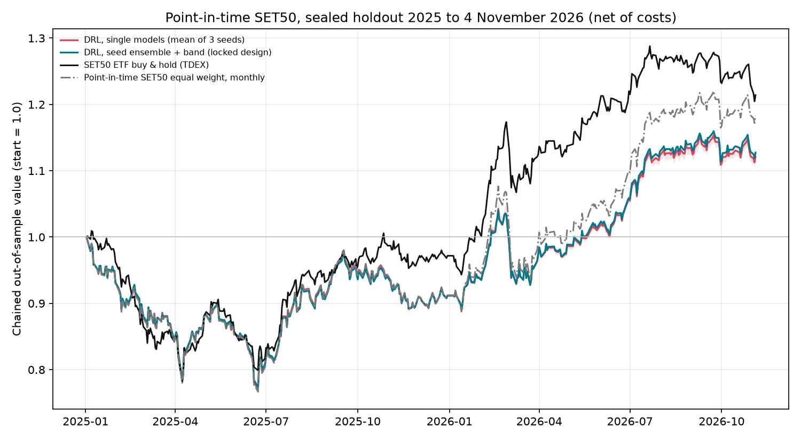

# The Sealed Holdout, 2025 to 4 November 2026 (M6)

Date: 2026-11-26
Status: **both stages done.** The five-stock stage ran once. The point-in-time stage failed at loading on its first attempt, before any model was trained, and ran once more after an approved fix.
Locks: `config/holdout_protocol_pit.yaml` and `config/holdout_protocol_five_stock.yaml`, approved as drafted in chat on 2026-11-26 by Nathawat Youngyim, who chose to record only that name (commit `83c9fd1`). The point-in-time retry was approved in chat the same day ("Yes, retry it"; commit `5c3d961`). Stage design: [holdout stage](holdout_stage_20261126.md).

## Summary

- **Point-in-time SET50 (headline):** the locked DRL design matched equal weight in 2025 (−8.8% each) but trailed it in 2026 to 4 November (+23.7% against +29.7%). It held up to its 20% cash cap through a rally. One baht became 1.128, against 1.183 for equal weight and 1.214 for the SET50 ETF.
  - Its Sharpe shortfall against equal weight, −0.12 (−0.23 to −0.01), is **significant**: on the years nobody had seen, the design did worse than equal weight of the same members.
  - Against the ETF the shortfall, −0.27 (−1.04 to +0.55), is not significant.
- **Five starter stocks (secondary):** A2C at 300k made 0.7% in 2025 and 14.3% in 2026 to 4 November. One baht became 1.153, against 1.281 for equal weight of the same five stocks and 1.214 for the ETF. It trailed both, not significantly.
- **Stale prices** are rare in the holdout (0.2–1.8% of rows, against 17.5% of stock rows in 2024), so the 2024 data defect does not recur.
- **Across the test years and the holdout,** no DRL design beat equal weight of its own universe significantly. The headline design was ahead in both test years (not significantly) and behind over the holdout (significantly, by Sharpe ratio).

## Point-in-time SET50 (headline)

Two folds: 2025, trained on everything through 2024; and 2026 to 4 November, trained on everything through 2025. Three seeds, the seed ensemble with the 0.5-point no-trade band, 0.20% cost per side, 443 daily returns. SET50 membership after 2024 is the 2024 H2 list held fixed (47 tradable members a session). Run 15:12–16:19 with three workers. The ensemble's replay check matched its seeds' saved curves to within 2.2 × 10⁻¹⁶.

| Policy | 2025 | 2026 to 4 Nov | Chained | Sharpe | Worst drawdown 2025 / 2026 | Average cash 2025 / 2026 | Turnover in the fold |
| --- | ---: | ---: | ---: | ---: | --- | --- | --- |
| **DRL, cash-capped, ensemble + band (locked)** | **−8.8%** | **+23.7%** | **1.128** | **0.48** | −22.6% / −10.8% | 2.7% / 16.6% | 1.3× / 1.0× |
| DRL, single models (mean of 3 seeds) | −8.8% | +22.9% | 1.121 (seeds 1.113–1.128) | 0.46 | −23.0% / −11.0% | 2.0% / 17.6% | 3.6× / 3.1× |
| Equal weight, monthly | −8.8% | +29.7% | 1.183 | 0.60 | −23.3% / −13.1% | 0.4% / 0.5% | 1.8× / 1.5× |
| SET50 ETF, buy and hold | −2.8% | +24.9% | 1.214 | 0.75 | −22.6% / −9.0% | | |

- **Seeds:** 2025: −8.6%, −8.8%, −9.0%; 2026: +23.4%, +22.0%, +23.3% (seeds 42–44). Average cash in 2026: 12.6%, 20.3% and 19.9%, so two of the three seeds sat at the cap all year.
- **Against equal weight:**
  - Ensemble: Sharpe difference −0.12 (−0.23 to −0.01), significant.
  - Single models: −0.14 (−0.26 to −0.02), significant.
  - Selection-rule score (annualised log return above equal weight, median over the two folds): −3.0 points a year for the ensemble (2025 −0.07, 2026 −5.93) and −3.4 for the single models. It was −0.01 on validation and +1.89 on the test years.
- **Against the ETF:** ensemble −0.27 (−1.04 to +0.55), not significant. Equal weight against the ETF: −0.15 (−0.93 to +0.69), not significant.
- **Deflated Sharpe (22 designs):** ensemble 0.10, equal weight 0.13, ETF 0.17.
- **Reading:**
  - In falling 2025 the design held almost no cash and moved with equal weight to within 0.1 points.
  - In 2026 it held 17% cash on average through a rally in which equal weight made 29.7%, and so lost about 6 points. The cash came when it cost most, as the drift to cash in the validation and 300k runs suggested.
  - Over the holdout it traded less than equal weight, as it had in the test years, but that no longer offset the cash.

### The first attempt (failed before training)

- **What happened:** the stage first opened the sealed files at 14:42:42. All six training tasks stopped within 20 seconds, because the data loader refuses a series that appears in more than one price file. GULF.BK and TIDLOR.BK did: they were 2024 H2 SET50 members whose Yahoo histories start only in 2025, so the development price map gives them no series and neither development file has them, but both 2025+ downloads carry their new rows.
- **What was seen:** no model was trained or evaluated, and no return was computed for any policy. The only things seen were data checks: row counts, stale-row shares and the price steps where the files meet.
- **The fix (`901138a`):** the stage continues only series a development file already has, and lists the others in the receipt. In the retry these were GULF.BK and TIDLOR.BK in both stock files, and THCOM.BK in the additions file. Under the held 2024 H2 list none of them has a price series, so the fix does not change what the agent can trade.
- **The record:** the attempt is in the ledger as a started stage, followed by a `failed_before_training` line, and its folder is `results/holdout_point_in_time_attempt1_failed/` (no validation curves, no end receipt). The retry's lock names it in `retry_of`, and the gate checked both before running.

## Five starter stocks (secondary)

Same folds; five seeds; 443 daily returns. Run 14:43–15:02 with three workers.

| Policy | 2025 | 2026 to 4 Nov | Chained | Sharpe | Worst drawdown 2025 / 2026 | Average cash | Turnover in the fold |
| --- | ---: | ---: | ---: | ---: | --- | --- | --- |
| **A2C, 300k (mean of 5 seeds)** | **+0.7%** | **+14.3%** | **1.153** (seeds 1.020–1.226) | 0.59 | −24.8% / −8.6% | 24% / 22% | 4.0× / 3.4× |
| Equal weight, monthly | +6.0% | +20.8% | 1.281 | 0.94 | −18.3% / −10.3% | 0.4% / 0.5% | 1.5× / 1.3× |
| SET50 ETF, buy and hold | −2.8% | +24.9% | 1.214 | 0.75 | −22.6% / −9.0% | | |
| Ridge forecast, top two monthly | +1.9% | +21.7% | 1.240 | 0.59 | | | |

The DRL drawdowns are seed means of each model's worst drawdown in the fold.

- **Seeds:** 2025: +5.3%, −6.0%, +0.9%, −1.2%, +4.7%; 2026: +16.4%, +8.5%, +17.2%, +13.9%, +15.6% (seeds 42–46).
- **Against equal weight:** Sharpe difference −0.35 (−0.80 to +0.12), not significant.
- **Against the ETF:** −0.16 (−1.06 to +0.76), not significant.
- **Deflated Sharpe (14 designs):** A2C 0.17, equal weight 0.31, ETF 0.23.
- **Reading:** as in the test years, A2C trailed equal weight of its own five stocks. It held about a quarter of its value in cash and traded more than twice as much. It beat the ETF in falling 2025 and trailed it in rising 2026. The five stocks were chosen with hindsight, and one of them, KBANK, rose 83% over the holdout, so this universe says little about Thai stocks in general.

## Stale prices from 2025 on

Counted in the opened rows before training (`src/data/stale_rows.py`): zero volume with open, high, low and close equal to the previous close.

| File | Rows | Stale rows | Share |
| --- | ---: | ---: | ---: |
| Five starter stocks | 2,225 | 6 | 0.3% |
| Point-in-time, SET100 union download | 56,013 | 261 | 0.5% |
| Point-in-time, 2012–2024 additions | 25,810 | 453 | 1.8% |
| SET50 ETF | 444 | 1 | 0.2% |

The point-in-time counts are from the retry; the first attempt also counted the dropped series. Each file had one weekday on which fewer than half the series traded, which accounts for one stale row in most series. The 2024 defect, 17.5% of stock rows and 76 ETF days, does not recur at anything like that scale.

## Files

- `results/holdout_point_in_time/` (the retry) and `results/holdout_five_stock/`:
  - `holdout_config.yaml`, `holdout_data/` (the continued files), `holdout_data_receipt.json`, `stale_rows.json`, `tasks.txt`;
  - `runs/`, `ensemble/` (point-in-time), `summary/`;
  - `receipt_start.json`, `receipt_end.json`.
- `results/holdout_point_in_time_attempt1_failed/`: the failed first attempt.
- `results/FINAL_TEST_LEDGER.jsonl`: one line per started stage, and the failure record.
- `~/drl_runs/holdout_logs_20261126/`: `driver.sh`, `driver_retry.sh`, `driver.log`, `pit.log`, `pit_retry.log`, `five_stock.log`. The first driver's "point-in-time exit 0" line is a logging slip (its date stamp reset the exit status); the stage itself exited with the loader error.
- `~/drl_runs/holdout_figures_20261126/`: both figures redrawn with labels; the curves are identical to the stage summaries.
