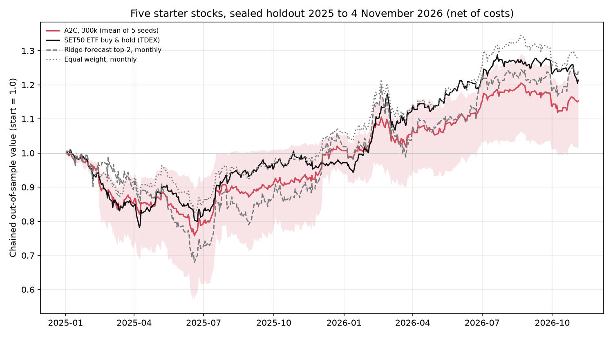

# The Sealed Holdout, 2025 to 4 November 2026 (M6)

Date: 2026-11-26
Status: the **five-stock stage ran once and finished**. The **point-in-time stage was opened but failed before any model was trained.** Its retry needs the authors' decision (below).
Locks: `config/holdout_protocol_five_stock.yaml` and `config/holdout_protocol_pit.yaml`. Both were approved as drafted in chat on 2026-11-26 by Nathawat Youngyim, who chose to record only that name, and committed as `83c9fd1`. Both stages ran at that commit. Stage design: [holdout stage](holdout_stage_20261126.md).

## Summary

- **Five starter stocks (secondary):** A2C at 300k made 0.7% in 2025 and 14.3% in 2026 to 4 November. One baht became 1.153, against 1.281 for equal weight of the same five stocks and 1.214 for the SET50 ETF. It trailed both, though not significantly. This matches the test years.
- **Point-in-time SET50 (headline):** the first attempt stopped at loading, before any training. Two series appeared in both sealed stock files: GULF.BK and TIDLOR.BK, 2024 SET50 members with no Yahoo history before 2025. No model was trained or evaluated, and no return on the holdout was seen. The fix is committed (`901138a`). A retry needs the authors' approval.
- **Stale prices** are rare in the holdout: 0.3% of five-stock rows, 0.5% and 1.7% of the point-in-time stock files and 0.2% of ETF rows, against 17.5% of stock rows in 2024.

## Five starter stocks (secondary)

Two folds: 2025, trained on everything through 2024; and 2026 to 4 November, trained on everything through 2025. Five seeds, 0.20% cost per side, 443 daily returns. Run 14:43–15:02 with three workers.

| Policy | 2025 | 2026 to 4 Nov | Chained | Sharpe | Worst drawdown 2025 / 2026 | Average cash | Turnover in the fold |
| --- | ---: | ---: | ---: | ---: | --- | --- | --- |
| **A2C, 300k (mean of 5 seeds)** | **+0.7%** | **+14.3%** | **1.153** (seeds 1.020–1.226) | 0.59 | −24.8% / −8.6% | 24% / 22% | 4.0× / 3.4× |
| Equal weight, monthly | +6.0% | +20.8% | 1.281 | 0.94 | −18.3% / −10.3% | 0.4% / 0.5% | 1.5× / 1.3× |
| SET50 ETF, buy and hold | −2.8% | +24.9% | 1.214 | 0.75 | −22.6% / −9.0% | | |
| Ridge forecast, top two monthly | +1.9% | +21.7% | 1.240 | 0.59 | | | |

The DRL drawdowns are seed means of each model's worst drawdown in the fold.

- **Seeds:** 2025: +5.3%, −6.0%, +0.9%, −1.2%, +4.7%; 2026: +16.4%, +8.5%, +17.2%, +13.9%, +15.6% (seeds 42–46).
- **Against equal weight:** Sharpe difference −0.35 (−0.80 to +0.12), not significant.
- **Against the ETF:** −0.16 (−1.06 to +0.76), not significant.
- **Deflated Sharpe (14 designs):** A2C 0.17, equal weight 0.31, ETF 0.23.
- **Reading:** as in the test years, A2C trailed equal weight of its own five stocks. It held about a quarter of its value in cash and traded more than twice as much. It beat the ETF in falling 2025 and trailed it in rising 2026. The five stocks were chosen with hindsight, and one of them, KBANK, rose 83% over the holdout, so this universe says little about Thai stocks in general.

## Point-in-time SET50 (headline): the first attempt failed before training

- **What happened:** the stage opened the sealed files at 14:42:42 and wrote the continued files and the stale-row counts. All six training tasks then stopped within 20 seconds. The data loader refuses a series that appears in more than one price file, and GULF.BK and TIDLOR.BK did. The stage exited with that error (`pit.log`). The driver's log line shows "exit 0" because its date stamp reset the exit status; that is a logging slip, not the stage's result.
- **Why:** GULF and TIDLOR were 2024 H2 SET50 members whose Yahoo histories start only in 2025, so the development price map gives them no series ("none") and neither development file has them. Both 2025+ downloads carry their new rows.
- **What was seen:** no model was trained or evaluated. The runner stopped before it built any baseline, so no return on the holdout, of any policy, was computed. The only holdout facts seen are data checks:
  - row counts: 56,750 and 26,620 stock rows, 444 ETF rows;
  - stale-row shares: 0.5%, 1.7% and 0.2%;
  - the largest price step where the files meet: 8.9% for a stock, 1.6% for the ETF.
- **The fix (`901138a`):** the stage continues only the series a development file already has, and lists the others in the receipt. Under the held 2024 H2 list, GULF and TIDLOR have no price series and cannot be held either way, so the fix does not change what the agent can trade. A synthetic run with the two series planted in both files passes end to end.
- **Where it stands:** the ledger records the attempt as a started stage, and its folder `results/holdout_point_in_time/` remains. The gate refuses to run the stage again.

### The authors' decision: retry or not

- **For a retry:** nothing about performance on the holdout was seen. The design, data, membership rule and statistics are unchanged; the only change is a loader fix that leaves the tradable set as it was.
- **Against:** the plan says the holdout is evaluated once. A strict reading treats the point-in-time holdout as spent, and the report would say so.
- **If yes:**
  1. Record the attempt as failed before training: `python -m scripts.run_holdout_evaluation --lock config/holdout_protocol_pit.yaml --record-failed-attempt "<reason>"`. It renames the folder to `results/holdout_point_in_time_attempt1_failed` and adds a `failed_before_training` line to the ledger. It refuses if anything was evaluated.
  2. Add `retry_of: results/holdout_point_in_time_attempt1_failed` to the lock, approve and commit it.
  3. Run the lock once.

  The session's permission check blocked me from recording the failure myself, because it edits the run-once ledger, so step 1 is the authors' to approve.

## Stale prices from 2025 on

Counted in the opened rows before training (`src/data/stale_rows.py`): zero volume with open, high, low and close equal to the previous close.

| File | Rows | Stale rows | Share | Series with any |
| --- | ---: | ---: | ---: | ---: |
| Five starter stocks | 2,225 | 6 | 0.3% | 5 of 5 |
| Point-in-time, SET100 union download | 56,750 | 263 | 0.5% | 128 of 128 |
| Point-in-time, 2012–2024 additions | 26,620 | 455 | 1.7% | 60 of 61 |
| SET50 ETF | 444 | 1 | 0.2% | 1 |

Each file had one weekday on which fewer than half the series traded, which accounts for one stale row in most series. The 2024 defect, 17.5% of stock rows and 76 ETF days, does not recur at anything like that scale.

## Files

- `results/holdout_five_stock/`: `holdout_config.yaml`, `holdout_data/` (the continued files), `holdout_data_receipt.json`, `stale_rows.json`, `tasks.txt`, `runs/`, `summary/`, `receipt_start.json`, `receipt_end.json`.
- `results/holdout_point_in_time/`: the failed attempt (no `receipt_end.json`, no validation curves).
- `results/FINAL_TEST_LEDGER.jsonl`: one line per started stage.
- `~/drl_runs/holdout_logs_20261126/`: `driver.sh`, `driver.log`, `pit.log`, `five_stock.log`.
- `~/drl_runs/holdout_figures_20261126/five_stock/`: the figure redrawn with labels (curves identical to the stage summary).
