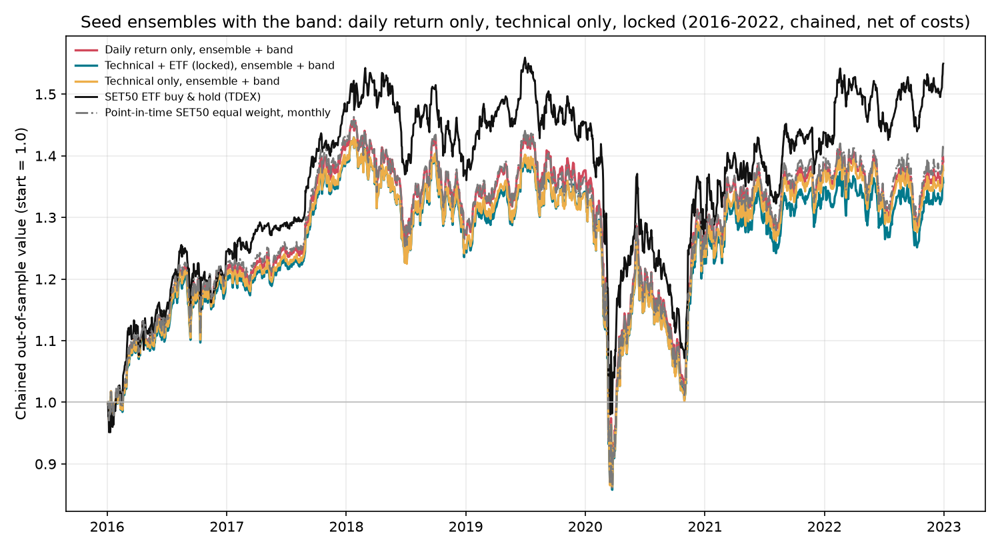

# A Price-Only Arm of the Locked Point-in-Time Design (RQ2)

Date: 2026-11-28
Status: **done, validation years 2016–2022 only.** The locked design and its test-year and holdout results are unchanged. This is a check made after them, not a new selection.
Run: local pool, three workers, 2026-11-28 09:05 to 19:37 (35 models). Config `config/pit_price_only_cashcap.yaml` (test `tests/test_pit_price_only_config.py`); pool `slurm/pools/local_20261128_price.tasks`.

## Summary

- **Question (RQ2):** does the agent need more than prices? RQ2 compares multi-source agents with "price-only and technical-indicator-only agents", and the plan's cumulative ablation starts from price. Until now the simplest arm was technical inputs only.
- **The arm:** the locked design with one stock input, each stock's daily return, and no market inputs. Each member's LSTM still sees its own 30-session window, so it can compute momentum or volatility itself. Everything else is held fixed: the shared-weight actor, sticky slots, the 20% cash cap, the plan reward, weekly decisions, 0.20% cost per side, 100k timesteps, seeds 42–46 and folds 2016–2022. It trained on the Mac, like the locked design.
- **The daily return alone does as well.** The single models made 4.8% a year against 4.6% for the locked design (Sharpe difference +0.006, −0.013 to +0.028) and 4.5% for technical inputs only (+0.007, −0.019 to +0.034). The seed ensembles with the band made 5.4% against 5.0% (+0.016, −0.007 to +0.046) and 5.2% (+0.004, −0.029 to +0.041). No difference is significant.
- **So neither the ten technical indicators nor the five ETF inputs add measurable value** over the stocks' own daily returns. The 2026-11-27 source ablation had already found the same for the ETF inputs.
- **Why it is slightly ahead:** it stays closer to equal weight. It holds 3.3% cash against 5.1% for the locked design, turns over 2.8 times its capital a year after entry against 3.3, and pays 0.78 points a year in costs against 0.88. Its seeds also agree more: a fold's return varies by 0.60 points across seeds, against 0.93.
- **It still does not beat equal weight.** Its ensemble's Sharpe ratio is 0.37 against 0.38 (−0.006, −0.035 to +0.033). Its single models are significantly worse than equal weight (−0.043, −0.080 to −0.016), like every single-model design.
- **Decision-7 still selects equal weight.** The price-only ensemble scores −0.35 points a year, behind the locked ensemble's −0.16: its mean return is higher, but its median year is not.

## Results (validation years 2016–2022, 100k timesteps, 5 seeds, 0.20% cost per side)

| Policy | 2016 | 2017 | 2018 | 2019 | 2020 | 2021 | 2022 | Mean a year | Chained | Sharpe | Mean max drawdown |
| --- | ---: | ---: | ---: | ---: | ---: | ---: | ---: | ---: | ---: | ---: | ---: |
| **Daily return only, ensemble + band** | 21.6% | 16.4% | −9.7% | 7.6% | −8.9% | 10.6% | 0.4% | **5.4%** | 1.391 | 0.37 | −12.5% |
| Technical only, ensemble + band | 20.8% | 15.3% | −9.9% | 6.7% | −7.7% | 11.4% | 0.0% | 5.2% | 1.377 | 0.37 | −12.2% |
| Technical + ETF (locked), ensemble + band | 19.9% | 15.8% | −10.0% | 7.4% | −8.7% | 10.0% | 0.7% | 5.0% | 1.357 | 0.36 | −12.2% |
| **Daily return only, single models (mean of 5 seeds)** | 20.1% | 14.9% | −10.4% | 6.6% | −8.2% | 10.3% | −0.1% | **4.8%** | 1.334 | 0.34 | −12.7% |
| Technical + ETF (locked), single models | 19.6% | 14.8% | −10.3% | 6.0% | −7.5% | 9.6% | −0.2% | 4.6% | 1.319 | 0.33 | −12.5% |
| Technical only, single models | 20.0% | 14.8% | −10.2% | 5.4% | −8.0% | 10.2% | −0.4% | 4.5% | 1.316 | 0.33 | −12.4% |
| Equal weight, monthly | 22.2% | 16.5% | −10.0% | 6.5% | −8.5% | 11.9% | 0.7% | 5.6% | 1.407 | 0.38 | −12.7% |
| SET50 ETF, buy and hold | 24.5% | 18.2% | −6.5% | 5.7% | −11.8% | 12.1% | 7.8% | 7.1% | 1.549 | 0.50 | −11.2% |

The technical-only arm is from BistKA job 4528 ([source ablation](source_ablation_20261127.md)); the locked design and the price-only arm trained on the Mac. "Chained" is the value of 1 baht over the seven years (for single models, the mean of the five seeds' chained curves).



| | Gross return a year | Cost drag a year | Turnover a year after entry | Average cash | Models above 15% cash | Seed spread | Decision-7 score | Years ahead of equal weight |
| --- | ---: | ---: | ---: | ---: | ---: | ---: | ---: | ---: |
| Daily return only, single | 5.5% | 0.78 pts | 2.8× | 3.3% | 2 of 35 | 0.60 pts | −0.82 | 2 |
| Technical + ETF (locked), single | 5.4% | 0.88 pts | 3.3× | 5.1% | 3 of 35 | 0.93 pts | −0.96 | 1 |
| Technical only, single | 5.7% | 1.15 pts | 4.6× | 6.0% | 5 of 35 | 0.85 pts | −1.19 | 1 |
| Daily return only, ensemble + band | 5.8% | 0.33 pts | 0.6× | 3.4% | | | −0.35 | 2 |
| Technical + ETF (locked), ensemble + band | 5.3% | 0.32 pts | 0.6× | 5.4% | | | **−0.16** | 1 |
| Technical only, ensemble + band | 5.6% | 0.40 pts | 1.0× | 5.7% | | | −0.48 | 3 |
| Equal weight, monthly | 6.0% | 0.40 pts | 0.9× | 0.7% | | | 0 | |

The seed spread is the standard deviation of a fold's return across the five seeds. The decision-7 score is the median over years of the annualized log return above equal weight, in points a year (`scripts/rank_final_candidates.py`).

### Sharpe differences

Block bootstrap on 1,699 chained daily returns; 95% intervals; "significant" means the interval excludes zero.

| Comparison | Difference | 95% interval | Significant |
| --- | ---: | --- | --- |
| *Same platform (Mac), against the locked design* | | | |
| Daily return only, single − locked single | +0.006 | −0.013 to +0.028 | no |
| Daily return only, ensemble − locked ensemble | +0.016 | −0.007 to +0.046 | no |
| *Against technical only (BistKA)* | | | |
| Daily return only, single − technical only, single | +0.007 | −0.019 to +0.034 | no |
| Daily return only, ensemble − technical only, ensemble | +0.004 | −0.029 to +0.041 | no |
| *Against equal weight and the ETF* | | | |
| Daily return only, ensemble − equal weight | −0.006 | −0.035 to +0.033 | no |
| Daily return only, single − equal weight | −0.043 | −0.080 to −0.016 | yes (worse) |
| Daily return only, ensemble − ETF | −0.123 | −0.370 to +0.108 | no |

Deflated Sharpe ratios, counting 36 designs tried on these validation years (the earlier 35 and this one): 0.13 for the price-only ensemble, 0.13 for equal weight and 0.20 for the ETF.

## Does the agent use the daily returns?

`scripts/pit_feature_group_attribution.py` re-ran each of the 35 models on its validation year with the daily returns shuffled across sessions (five times) or held at their training mean, the model unchanged. Every model first replayed its saved curve exactly (largest gap 2 × 10⁻¹⁶).

- **It reads them.** Shuffling them moves the portfolio by 3.8% on average (0.1% to 13.3% by model), about as much as the eleven technical inputs move the locked design's (4.1%).
- **The tilts it takes from them cost a little.** Held at their training mean, every stock looks the same to the shared-weight actor, so it weights all members equally and only its cash differs. That raises the return by 0.26 points a year on average, for 26 of 35 models. Holding the technical inputs at their mean did the same for the locked design (+0.5 points, 17 of 21 models) and for the sector arm (+0.30 points, 22 of 35).
- **Cash does not follow the returns.** Neither change moves any model's average cash by more than 4.7 points.

## Reading the result

- **The extra inputs are not where the agent's information comes from.** On the point-in-time SET50, a shared-weight LSTM over each stock's 30 daily returns does as well as one over eleven engineered indicators plus the SET50 ETF, and slightly better on average. The policy rate, the macro proxies and the sector (2026-11-27 and 2026-11-28) also left the result unchanged. The cumulative ablation (price → + technical indicators → + index) is therefore flat at every step.
- **Fewer inputs, fewer costly tilts.** Every learned design trails equal weight before costs as well as after: their stock tilts do not pay. With one input, the agent tilts less (its weights are 5.1% from equal weight in total-variation distance, against 7.5% for the locked design), holds less cash and trades less, so it loses less to equal weight.
- **For RQ2:** the multi-source agents are no better than a price-only agent, and none of them beats equal weight. The leave-one-source-out runs of BistKA job 4609 (submitted 2026-11-28) test the same question with every source switched on, including leaving out the technical indicators.

## Compute

- **Local pool:** 35 models on three workers, 09:05 to 19:37 (10.5 hours). The median model took 25 minutes (1,521 seconds), a little faster than the locked design's, since the observation has 3,051 values instead of 25,551. Between about 09:30 and 16:20 the Mac ran slower, for reasons the logs do not show, and tasks took up to 3.5 hours; from 16:20 each took about 25 minutes again. None failed.
- **Analysis:** the seed ensemble, aggregation, diagnostics and decision-7 took a few minutes, and the attribution a few minutes on three workers.

## Files

- `~/drl_runs/pit_walk_forward_price_cashcap_20261128/`: the 35 models with the pool log.
- `~/drl_runs/pit_src_price_ensemble_20261128/`: the seed ensemble with the band, its replay check (largest gap 2 × 10⁻¹⁶) and diagnostics.
- `~/drl_runs/pit_walk_forward_combined_price_20261128/`: summary, fold returns, metrics, significance against equal weight, the ETF, the locked design and technical only (single and ensemble), single-model diagnostics, the figure, `ensembles_only/` and `decision7/`.
- `~/drl_runs/pit_attribution_price_20261128/`: the attribution, per year and merged.
- `config/price_candidates_20261128.yaml`: decision-7 inputs.

## Commands

```bash
R=~/drl_runs; V=pit_plan_weekly_lstm_shared_cashcap; S=$R/pit_walk_forward_price_cashcap_20261128
E=$R/pit_src_price_ensemble_20261128; O=$R/pit_walk_forward_combined_price_20261128
bash scripts/run_task_pool.sh slurm/pools/local_20261128_price.tasks 3
python -m scripts.evaluate_pit_seed_ensemble --config config/pit_price_only_cashcap.yaml --source-run $S \
  --variant pit_cashcap_src_price --seeds 42 43 44 45 46 --output-dir $E --band 0.005 --modes ensemble_band
python -m scripts.walk_forward_agent_diagnostics --run-dir $E --variant pit_cashcap_src_price_ensemble_band \
  --prefix diagnostics_ensemble_band
python -m scripts.walk_forward_agent_diagnostics --run-dir $S --variant pit_cashcap_src_price --output-dir $O \
  --prefix diagnostics_single_price
python -m scripts.aggregate_walk_forward_reward --run-dir $S \
  --extra-run-dirs $E $R/pit_walk_forward_cash_cap_100k_5seeds_20261125 $R/pit_cash_cap_ensemble_100k_5seeds_20261125 \
    $R/pit_source_ablation_cashcap_bistka_20261126 $R/pit_src_technical_ensemble_20261127 \
  --variants pit_cashcap_src_price $V pit_cashcap_src_technical --seeds 42 43 44 45 46 --n-trials 36 --output-dir $O \
  --references pit_equal_weight_monthly ${V}_ensemble_band $V pit_cashcap_src_technical pit_cashcap_src_technical_ensemble_band
python -m scripts.rank_final_candidates --candidates config/price_candidates_20261128.yaml --base $R --output-dir $O/decision7
for y in 2016 2017 2018 2019 2020 2021 2022; do
  python -m scripts.pit_feature_group_attribution --config config/pit_price_only_cashcap.yaml --run-dir $S \
    --variant pit_cashcap_src_price --fold-years $y --output-dir $R/pit_attribution_price_20261128/fold_$y
done
```

The aggregation was run with `--title` and `--labels` for the figures (see `~/drl_runs/logs_price_20261128/`). The ensembles-only figure is the same command with `--variants` given no names and `--output-dir $O/ensembles_only`.
