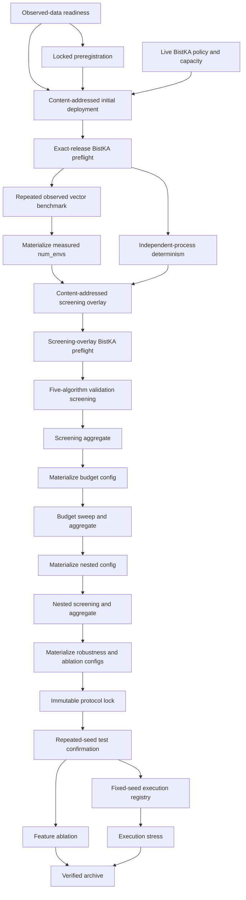

# Research Campaign Control Plane

> **Live V2 screening update (evidence through 2026-07-26):** canonical whole-project completion remains **11/37 = 29.7%**. The active consolidated graph is **9 VERIFIED, 1 READY (`screening`), and 25 PENDING** across 35 stages; `calibration_lineage` replaces three former gates with one, so the native 9/35 fraction is not a loss of progress. The storage-safe release is applied, exact-release preflighted, and verified by job `3550`. A fresh 26 July execution window passed the queue, credit, write-probe, runtime, campaign, SLURM, and exact-release checks but was held because its 0.308 GiB personal-group margin was below the 1 GiB safety policy. The full 150-trial screening remains unsubmitted, and the 26 July work submitted zero jobs. The report body from “Technical Summary” onward is retained as the historical V1 account; current V2 evidence is summarized immediately below.

## Storage-Safe Cutover Is Verified

The control plane now uses the no-checkpoint path that prevents the quota failure observed in job `3542`. Before changing it, the project archived the prior control plane and release, preserved original specification identity, and accepted calibration without recomputation through a checksum-bound lineage receipt. Final release `56358f2a4996f654426814d88e622b7f217ac89bfc02f8bbdacc27e66873b55e` contains 248 files totaling 7,850,129 bytes. Its exact BistKA preflight verified all 248 files, the locked observed-market data, runtime packages, and zero issues.

| Active V2 artifact | Verified identity |
| --- | --- |
| Calibration lineage | [`receipt`](../campaigns/large_scale_thai_drl_v2/imports/storage_safe_cutover_calibration_lineage.json), SHA-256 `25cda3f51aeb200353064e495fd58484ade711f36ca575c9633ae231e069c807` |
| Rollback archive | [`archive`](../campaigns/large_scale_thai_drl_v2/cutovers/storage_safe_20260717_pre_cutover/pre_cutover_control_and_release.tar.gz), SHA-256 `5dd485c41ee5e287c893081f760f1f496fb458e1e1097e691fb64e254e822aee` |
| Active release | `56358f2a4996f654426814d88e622b7f217ac89bfc02f8bbdacc27e66873b55e`; 248 files; 7,850,129 bytes |
| Active manifest and bundle | SHA-256 `439b590bc4a85f03a6d98723ee3d28e40acdc00d95bdfbf48d310f07d867e25c` and `a5135665dd14fdfcd0a5dcdbfab70a7e6f88fd78fc75ff946df9851c01a4072e` |
| Active BistKA preflight | [`receipt`](../reports/bistka_screening_storage_safe_cutover_v2_preflight.json), SHA-256 `1ccac9827e2f018927d711c0fb0918119c79f8721bd6d82d3d08ed026ab59f0c` |
| Verified storage-safe smoke | Job `3550`; [`results`](../results/screening_storage_safe_smoke_3550/), summary SHA-256 `e3095e1149a6cefe9d12cef97ca38b0b1ef1585bfa3e4d20bf66a4ce977b88c3` |
| Dedicated zero-checkpoint gate | [`receipt`](../results/screening_storage_safe_smoke_3550/storage_safe_smoke_validation.json), SHA-256 `cd3cf4b65306894e8b50068bf21ff9d6c65ab018fb8718317c50c858f3c5b507` |
| Strict smoke import | [`receipt`](../reports/screening_storage_safe_smoke_3550_import_validation.json), SHA-256 `dca91a1f94c4339ed524c94fa667362f2f6aebf414ff3b9984717e1bb77cd5fb` |

Job `3550` completed in 33 minutes 20 seconds with exit `0:0`, 2 CPUs, 32:33.567 total CPU, and 809680K maximum batch RSS. It produced five complete manifests, five signed retention receipts, and zero checkpoint artifact paths. Its 137,777,145-byte footprint is about 49.94% smaller than the 275,209,516-byte accepted checkpoint-writing smoke even though it adds seven evidence files. All replacement runtime projections remain below 72 hours: PPO 3.7285 h, A2C 0.2556 h, DDPG 20.4114 h, TD3 21.1114 h, and SAC 21.5986 h.

## Full Screening Remains Unsubmitted

The pre-smoke capacity capture passed all eight byte/inode checks and a 1 MiB `fsync` probe with 0.417 GiB modeled margin, authorizing only job `3550`. The post-smoke capture also passed, but margin narrowed to 0.309 GiB. Both decisions are historical after their 15-minute freshness window and cannot authorize a later submission. V2 has five jobs to date (`3540`, `3541`, `3542`, `3543`, and `3550`), with only `3550` submitted in the final cutover window.

[`reports/screening_storage_safe_cutover_execution_20260717.md`](../reports/screening_storage_safe_cutover_execution_20260717.md) is the current execution record, and the generated [`V2 campaign status`](../campaigns/large_scale_thai_drl_v2/reports/campaign_status.md) is the current machine handoff. Before full screening, open a separate authorized window, confirm the active marker and preflight, recapture quota/credit/queue evidence and the exact-output-path write probe, prefer materially more headroom, and submit only the one bounded screening array if the fresh decision passes. Do not pre-submit aggregation.

## The 26 July Execution Window Failed Closed

The new [`execution-window gate`](../scripts/prepare_screening_execution_window.py) closes the gap between historical campaign readiness and live submission safety. It verifies exact sidecars, four independent 15-minute timestamps, at least 120 seconds of usable receipt lifetime, empty user and whole-account queues, conservative project/user credit, exact QOS and partition limits, the current remote bundle/manifest markers, a fresh 248-file remote preflight, the complete local 248-file release, the pristine 0/150 campaign state, and the one permitted `0-4%2` SLURM shape. It is bound to the exact canonical job-`3550` smoke summary, recomputes the storage projection rather than trusting an older pass flag, restricts immutable receipts to a dedicated directory, and contains no `sbatch` execution path.

The authoritative fresh capture measured 6,806,358,016 bytes of group soft headroom against a 6,475,756,231-byte conservative requirement. The 330,601,785-byte (0.308 GiB) remainder was 743,140,039 bytes (0.692 GiB) below the required 1 GiB buffer. The fresh-window decision therefore returned exit code `2`, wrote no authorization receipt, rendered no campaign attempt, and submitted zero jobs. A final near-expiry revalidation also rejected the evidence when only 70 seconds remained, proving the independent minimum-TTL guard; a later stale-evidence run independently held every expired timestamp and again wrote nothing. Production policy floors are immutable, integer-only, and reject NaN/Boolean values; the CLI binds one same-stamp operational evidence/receipt set; receipt writing requires an unmodified gate-issued capability; path-component symlinks across command, attempt, status-report, and event-log outputs are rejected before controller rendering; and exclusive creation prevents overwrite races. The supported [`consume-once renderer`](../scripts/render_authorized_screening.py) revalidates on its own wall clock, uses an evidence-identity ledger and permanent stage lock, verifies the immutable attempt/self-hash/command exports, and records success or in-doubt failure without executing a job. Mandatory enforcement at the eventual submission boundary in the already manifest-locked controller is deliberately deferred to a new release rather than silently drifting the active deployment. The exact evidence and calculation are recorded in the [`26 July safety-hold report`](../reports/screening_execution_window_hold_20260726.md); 74 focused authorization/render cases and 124 authorization/quota/storage cases pass.

## Technical Summary

The project now has a **28-stage, dependency-gated observed-data campaign**. The resolved initial plan contains **498 model-training runs**, **29.44 million requested training timesteps**, and **23 bounded SLURM array elements** across validation-only screening and budget selection, nested walk-forward selection, repeated-seed test confirmation, and feature ablation. Calibration, execution stress, deployment, aggregation, and final archiving add gated stages without changing that model-run denominator.

The implementation separates local preparation, remote deployment verification, command rendering, compute, aggregation, and explicit evidence verification. It can build deterministic deployment bundles, validate exact BistKA releases, materialize scientific decisions, lock the protocol, and render one submission command at a time. It contains no path that calls `sbatch` automatically.

The scientific question, baselines, primary paired outcomes, validation/test firewall, negative-result rule, and claim exclusions are locked in a machine-readable preregistration. Calibration is also fail-closed: the observed vector benchmark and independent-process determinism check cannot become ready until the exact initial release has been staged on BistKA and its remote preflight receipt passes locally.

Five calibration-related jobs were submitted on BistKA: `3525`, `3526`, `3528`, `3529`, and `3530`. The first three exposed a per-user Lustre quota failure, and job `3529` completed but was rejected by the local gate because it read a stale Parquet data shadow. Rejected result artifacts from diagnostic job `3528` and stale-data job `3529` are preserved under [`reports/rejected_calibration/20260715_quota_and_data_shadow/`](../reports/rejected_calibration/20260715_quota_and_data_shadow/); the complete scheduler logs for all five jobs remain under [`logs/`](../logs/). None of that rejected evidence satisfies a campaign gate. Combined recovery job `3530` completed against the corrected, release-bound CSV and is the only accepted calibration job. No further job was submitted after reaching the requested five-job ceiling.

The current local state is **10 VERIFIED, 1 READY, and 17 PENDING**. The corrected 149-file initial release has release ID `6d66448341c780c5b90a2d2d54cf2b4d4bebd972a18885aad727a05ff8236aaa` and contains 5,365,177 uncompressed bytes. Its exact runtime feature is [`data/processed/features_real_ohlcv_market.csv`](../data/processed/features_real_ohlcv_market.csv), 2,183,530 bytes with SHA-256 `b877b08ed7a022db47739423291df0232ce377869cb7e0de6162ab82291ac6cc`. Exact-release preflight, vector calibration, independent-process determinism, measured screening configuration, screening overlay, and screening-overlay preflight have all passed. Five-algorithm validation screening is the sole ready compute stage, but it was deliberately not submitted because the five-job ceiling had already been reached. The generated [`campaign status`](../campaigns/large_scale_thai_drl/reports/campaign_status.md) and [`calibration execution report`](../reports/bistka_calibration_execution_20260715.md) contain the machine-backed handoff.

The frozen private-research snapshot contains 4,840 daily stock rows across five Thai tickers, 965 SET-index rows, and 4,840 processed market-context rows covering 4 January 2021 through 30 December 2024. This is execution-eligible observed evidence for a private educational pilot, not publication-grade evidence. The source restrictions, fixed five-stock universe, lack of point-in-time membership, and scaffolded macro/sentiment columns prohibit raw redistribution and broad SET, sentiment, official-macro, or publication-grade performance claims.

## The Campaign Is Large but Staged

The workload denominator is a model-training run: one algorithm/configuration/seed/window or feature-group/seed/window combination. Calibration, aggregation, capacity checks, deployment, preflight, configuration materialization, and archive verification do not count as model runs.

| Campaign component | Experimental grid | Model runs | Requested timesteps |
|---|---:|---:|---:|
| Five-algorithm screening | 5 algorithms × 30 trials | 150 | 3.00M |
| Training-budget sweep | 4 budgets × 2 algorithms × 3 seeds × 2 windows | 48 | 10.44M |
| Nested validation | 5 algorithms × 2 windows × 10 trials | 100 | 2.00M at the initial 20k budget |
| Repeated-seed robustness | 2 algorithms × 2 windows × 20 seeds | 80 | 8.00M at the initial 100k budget |
| Feature ablation | 6 groups × 2 windows × 10 seeds | 120 | 6.00M at the initial 50k budget |
| **Total** | **23 bounded array elements** | **498** | **29.44M** |

Budget-dependent stages are rematerialized after validation selection. Therefore, 29.44M is the resolved initial plan, not a promise that every later stage will retain its initial timestep value.

## The 28-Stage Chain Fails Closed

Compute arrays and aggregators remain separate stages. An aggregate command is unavailable until the corresponding compute stage has the exact expected number of complete manifests and is explicitly verified. This prevents the controller from pre-submitting an array plus its aggregate and consuming BistKA's small submitted-job allowance.

## Scope, Evidence, and State Definitions

The canonical campaign specification is [`config/research_campaign.yaml`](../config/research_campaign.yaml). The controller implementation is under [`src/campaigns/`](../src/campaigns/), and the generated state report is written to [`campaigns/large_scale_thai_drl/reports/campaign_status.md`](../campaigns/large_scale_thai_drl/reports/campaign_status.md).

Each stage is evaluated from saved evidence rather than directory names alone:

- `READY` means every dependency is verified and exactly one operator action can be rendered.
- `PENDING` means at least one dependency still needs explicit verification.
- `RUNNING` or `FAILED` comes from experiment manifests.
- `VERIFY_PENDING` means completion evidence passes, but no success marker exists yet.
- `VERIFIED` requires a passing gate report and an immutable `_SUCCESS.json` fingerprint.
- `BLOCKED` denotes missing external inputs or invalid evidence.
- `STALE` means evidence or a verified dependency changed after verification.

A zero-exit scheduler job is never sufficient for `VERIFIED` status. Likewise, implementing a runner does not make its campaign stage complete: BistKA-produced artifacts must return and pass their local gates.

## Preregistration Locks the Scientific Contract

[`config/research_preregistration.yaml`](../config/research_preregistration.yaml) and its SHA-256 sidecar lock the following before final test access:

- the fixed five-ticker Thai-market pilot question and unit of analysis;
- equal-weight and SET-index buy-and-hold as the primary baselines;
- net cumulative return, Sharpe, and maximum drawdown as paired primary outcomes;
- validation-only algorithm, hyperparameter, and budget selection;
- test-only conclusions and a prohibition on post-test tuning;
- Holm family-wise correction and the negative-result rule;
- the exact observed period, universe, and readiness-receipt hash; and
- explicit exclusions for whole-SET generalization, sentiment effects, official-macro effects, and publication-grade performance.

The registration is immutable for this study version. Any post-test amendment requires a new study version and a new untouched holdout; the existing registration is never overwritten.

## The Real-Data Gate Verifies Content and Provenance

The observed-market readiness stage requires a machine-readable receipt rather than accepting filenames alone. It verifies the five-ticker contract, unique daily grain, finite positive prices, OHLC envelopes, temporal coverage, balanced ticker histories, SET-index coverage, exact feature keys, configured observation columns, leakage checks, and file hashes. Generated-origin data is rejected even if it is renamed to an expected filename, and later source drift makes the gate stale.

All critical and high-severity checks pass. Three medium warnings remain: ten adjusted-price rows across all five tickers required deterministic OHLC-envelope normalization; the public SET-index series lacks same-day observations on 2 April 2021, 25 December 2023, and 25 December 2024; and the macro/sentiment columns are constant scaffolds rather than historical contextual evidence. Index levels are aligned backward without future observations and include a same-day-availability indicator.

## Deployment Is Content-Addressed and Preflight-Bound

The initial deployment builder creates a deterministic archive, a complete file inventory, a content-derived release ID, and SHA-256 sidecars. Its manifest binds the observed data, readiness evidence, preregistration, configurations, code, SLURM scripts, dependency declarations, target project root, BistKA Python executable, required hostname prefix, and required runtime packages.

The staging helper defaults to a dry run. An explicit `--apply` is required to upload anything; before extraction it verifies the archive hash and backs up every manifest-listed remote file that would be replaced. The corrected initial release was explicitly applied, and its returned [`BistKA preflight receipt`](../reports/bistka_calibration_preflight.json) verifies all 149 release files plus the actual runtime feature binding.

The first BistKA preflight must run from the declared remote project root with the declared environment. It verifies every deployed file hash, the exact release ID and file count, the BistKA hostname, observed-data eligibility, Python runtime, and required packages. The locally returned receipt must match the local manifest byte-for-byte by hash before calibration can advance.

After measured vector selection and determinism verified, the campaign built a second content-addressed overlay containing the locked calibrated screening configuration, decision evidence, and corrected feature table. The six-file overlay has release ID `47c3399e62fd5a162c2ea1a6e057af054aedac7604c58242a954a5d44cc1118d`; its returned [`screening preflight receipt`](../reports/bistka_screening_preflight.json) passed and made five-algorithm screening ready.

The downstream deployment audit found the next control-plane gap. The initial and screening releases are closed, but future materialized configurations are not yet covered by cumulative, exact-release deployment gates. Before any future compute submission, implement five cumulative release/apply/preflight checkpoints, positioned before `budget_sweep`, `nested_screening`, `robustness`, `feature_ablation`, and `execution_stress`. Each checkpoint must include all previously verified release content plus its newly materialized configuration and decision evidence. Aggregate stages must inherit the verified release identity from their `run_source` compute stage and fail closed if that binding is missing or different. The earliest actionable gap is the checkpoint before `budget_sweep`.

## Calibration Is Attempt-, Deployment-, and Preflight-Bound

Each calibration command render creates an immutable attempt record that hashes the campaign specification, job script, configuration, code, data, readiness evidence, dependency declarations, deployment release, and preflight receipt. Only an explicit allowlist is exported to SLURM; the renderer does not inherit the caller's full environment.

The returned calibration receipt must identify the latest rendered attempt, campaign and stage, BistKA hostname, positive SLURM job ID, deployment release ID, and preflight hash. It must also provide matching input/output hashes, file sizes, code/config/data provenance, runtime package versions, elapsed time, and an error-free success status. Old receipts, another attempt's outputs, locally fabricated hostnames, changed inputs, or mismatched job-numbered filenames fail closed.

The observed vector benchmark is defined as 1, 2, 4, 8, and 16 environments, each repeated three times. Every trial runs in a fresh Python subprocess against the declared observed training split and records throughput plus sampled concurrent process-tree RSS. Selection uses median samples per second and chooses the smallest environment count reaching at least 95% of the maximum median throughput.

Accepted job `3530` selected **`num_envs: 1`**. Its median throughput for 1, 2, 4, 8, and 16 environments was respectively **347.9200, 265.9007, 217.0773, 143.4171, and 83.6104 samples/second**; maximum sampled process-tree RSS was **602.484, 1,641.066, 2,661.281, 4,690.129, and 8,768.617 MiB**. On this workload, adding vector environments reduced throughput while increasing memory. Large HPC capacity should therefore be spent on independent algorithms, trials, seeds, windows, and ablations rather than forcing more environments into one learner. The accepted [`benchmark summary`](../reports/vectorized_training_benchmark_3530.json), [`trial CSV`](../reports/vectorized_training_benchmark_3530.csv), and [`receipt`](../reports/vectorized_training_benchmark_3530.csv.receipt.json) retain the complete evidence.

The determinism stage runs the same fixed-seed observed-data trajectory in two independent Python processes and requires identical trajectory hashes and provenance. Accepted job `3530` was deterministic for **549 steps** across two independent worker processes; the [`result`](../reports/determinism_3530.json) and [`receipt`](../reports/determinism_3530.json.receipt.json) are bound to the same release, preflight, attempt, and corrected CSV. Synthetic inputs are available only through an explicit unit-test mode and cannot satisfy the observed campaign gates.

The materializer independently recomputed the medians and selection rule and wrote the [`locked screening configuration`](../campaigns/large_scale_thai_drl/derived/locked_large_scale_screening.yaml) with `training.num_envs: 1`. Its decision receipt and SHA-256 sidecars bind that configuration to the accepted attempt, benchmark CSV, metadata, receipt, base configuration, and selected value.

## Validation Decisions Are Propagated, Not Re-entered Manually

After calibrated screening, the control plane materializes the later validation-derived configurations:

1. The budget configuration receives the top one or two validation-selected algorithms.
2. The nested configuration receives the selected training budget while retaining the declared five-algorithm nested grid.
3. The robustness configuration receives the selected algorithms, common budget, and algorithm/window-specific nested hyperparameters.

Feature ablation receives the primary selected algorithm, common budget, and its per-window settings. Every derived configuration includes source hashes and a validation-only provenance record.

After robustness is complete, the controller materializes the execution-stress registry automatically. It uses the exact screening decision frozen in the protocol lock and the predeclared stress seed for every selected algorithm and walk-forward window; it never ranks candidate seeds using test performance. Each entry is bound to its model, manifest, resolved configuration, campaign, protocol lock, feature schema, data, and source evidence through SHA-256 checks.

The stress configuration routes each registered model only to its matching outer test window. The base scenario must exactly replay the corresponding robustness equity curve before hostile execution scenarios are accepted, preventing evaluation on a convenient or mismatched chronological slice.

## The Protocol Lock Creates a Split Firewall

Before any test-reading stage can be rendered, the controller hashes the campaign graph; preregistration; data-readiness evidence; observed raw and processed data; calibrated screening decision; initial and overlay deployment evidence; validation-only algorithm, budget, and nested selections; resolved robustness and ablation configurations; and execution-stress assumptions.

YAML and JSON inputs receive semantic hashes, so harmless key order or comments do not change the scientific protocol. A raw SHA-256 is retained for file audit. The lock is immutable: identical inputs reproduce the same lock, while scientific drift is refused rather than silently overwritten. Post-lock experiment manifests carry `campaign_id` and `protocol_lock_hash`; robustness, ablation, and stress gates reject a missing or mismatched hash.

## Live BistKA Policy Is Enforced

Authenticated live evidence captured on 15 July 2026 confirms:

- account `25sfcs03`;
- no more than five submitted jobs per group;
- no more than two running jobs per group;
- no more than 32 CPU cores and two GPUs per group;
- six-hour development, two-day normal, and four-day long partition limits;
- Python 3.10–3.13, Miniforge3 24/25, and CUDA 12.8/13.0 modules; and
- a configured project Python 3.12 environment with NumPy, pandas, PyTorch, Stable-Baselines3, Gymnasium, and PyYAML.

The 15 July snapshot also records 9,993.58 project service hours remaining through 28 February 2027, approximately 255.91 GiB free in project storage, 8.32 GiB free in home storage, and idle CPU partitions. These values are point-in-time evidence and must be recaptured if cluster policy, capacity, modules, or the runtime changes.

Every SLURM script is checked against the declared account, allowed CPU partitions, array size, array concurrency, CPU-per-task limit, and required log paths before planning. Commands are rendered one stage at a time, normalize `jobid;cluster` responses, and limit OpenMP, MKL, OpenBLAS, and NumExpr threads to prevent vector workers from multiplying BLAS threads.

## Validation Coverage Fails Closed

Automated coverage now includes:

- stable workload totals, the 28-stage dependency graph, unknown dependencies, duplicates, and cycles;
- exact manifest counts, unique experiment IDs, failed runs, and stale success markers;
- malformed live policy, credit, quota, partition, queue, and module evidence;
- preregistration structure, readiness-receipt binding, and checksum drift;
- deterministic deployment creation, manifest/file hash drift, BistKA-only preflight, and receipt mismatch;
- observed-only calibration inputs and explicit synthetic unit fixtures;
- repeated vector trial completeness, independent process IDs, RSS/provenance fields, and the 95%-of-peak selection rule;
- independent-process determinism and matching trajectory/provenance hashes;
- attempt, deployment, preflight, hostname, SLURM job ID, runtime, input, output, and current-source binding;
- calibrated `num_envs` materialization and refusal of stale, synthetic, or malformed benchmark evidence;
- validation-decision propagation, immutable protocol locking, and mandatory post-lock hashes;
- fixed-seed, window-aligned model-registry and exact stress-replay checks; and
- render-only commands that perform no submission themselves.

These tests validate the implementation and failure paths. They are not substitutes for the 498 planned model runs, downstream aggregates, or final archive verification. The two BistKA preflights and both calibration gates are now verified; the screening and later scientific runs remain unexecuted.

The final local validation pass reports **124 passing tests**, successful compilation of the source/scripts/tests, valid shell syntax for every checked shell and SLURM script, and passing cross-checks of the initial and screening release evidence.

## Limitations and Robustness Boundaries

This control plane validates research execution; it does not establish that DRL outperforms either baseline. The campaign has only two broad walk-forward windows, a fixed five-stock universe, no point-in-time constituent history, and a restricted public-web snapshot. Constant macro and sentiment features are pipeline scaffolds, not evidence of macroeconomic or sentiment effects.

Execution stress remains unavailable until robustness produces every required model and source artifact. The fixed-seed stress rule deliberately isolates execution assumptions for one preregistered seed; it does not quantify execution-stress uncertainty across training seeds. Feature ablation is also scientifically blocked until observed macro and fundamental tables pass readiness, or the preregistered feature scope is formally amended before test access. The final archive remains pending until both feature-ablation and execution-stress evidence verify.

## Recommended Next Steps

1. Do not submit screening while the execution-window gate reports `HOLD`; the 26 July evidence is already expired and was 0.692 GiB short of the required storage buffer even when fresh.
2. Obtain additional personal-group headroom through safe reproducible-cache cleanup, a quota increase, or project-group/SGID ownership support without deleting accepted evidence.
3. Recapture all live evidence through the trusted VPN/SSH channel, require a sealed checksum-bound `authorized: true` receipt, then render exactly once through `config/research_campaign_storage_safe.yaml`; inspect and explicitly submit only the five-element `%2` array before verifying all returned manifests.
4. Make every aggregate inherit its `run_source` release identity and fail closed on missing or mismatched release evidence.
5. Obtain readiness-certified observed macro and fundamental tables, or formally amend the feature-ablation scope before the protocol lock and any test-reading run.
6. Create the immutable protocol lock before any test-reading stage, then build and verify the reproducibility archive last.

## Further Questions

- What new submission window and operator ceiling should govern the ready 150-run screening array?
- Can licensed, point-in-time data support six or more genuinely distinct outer test windows and a survivorship-aware universe?
- Should a preregistered multi-seed execution-stress sensitivity analysis be added after the fixed-seed primary result?
- Should failed-only resume support be added after the first campaign reveals actual BistKA failure patterns?
