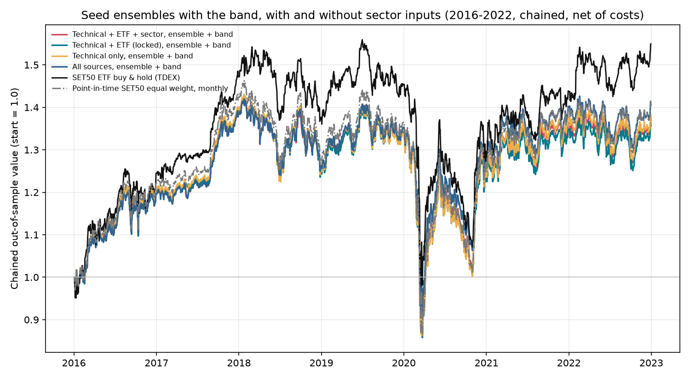

# Sector Inputs for the Locked Point-in-Time Design (M4, RQ2/RQ3)

Date: 2026-11-28
Status: **done, validation years 2016–2022 only.** The locked design and its test-year and holdout results are unchanged. This is a check made after them, not a new selection.
Run: local pool, three workers, 2026-11-27 19:30 to 2026-11-28 04:28 (35 models). Config `config/pit_sector_ablation_cashcap.yaml`; pool `slurm/pools/local_20261127_sector.tasks`; inputs `src/features/pit_sector_context.py` (tests in `tests/test_pit_sector_context.py` and `tests/test_pit_sector_ablation_config.py`).
Coverage of every input source: [source_coverage_20261127.md](source_coverage_20261127.md).

## Summary

- **Question (RQ2/RQ3):** does the stock's sector help the locked design? The sector was the one source left in M4 that the project's own data allow, with no download or licence. The SET membership archive gives every member's sector on each half-year SET50/SET100 list from 2012 to 2024.
- **The arm:** the locked design plus four stock-level inputs built from those dated sectors. Everything else is held fixed: the 11 technical and 5 SET50 ETF inputs, the 30-session window, the shared LSTMs, the shared-weight actor, sticky slots, the 20% cash cap, the plan reward, weekly decisions, 0.20% cost per side, 100k timesteps, seeds 42–46 and folds 2016–2022. It trained on the Mac, like the locked design, so the two compare on one platform.
- **No measurable gain.** The single models made 4.5% a year against 4.6% for the locked design (Sharpe difference −0.005, −0.033 to +0.027). The seed ensembles with the band made 5.1% against 5.0% (+0.010, −0.020 to +0.043). Against technical inputs only, the differences are −0.003 and −0.002. No interval excludes zero.
- **The models read the sector inputs, but gain nothing from them.** Shuffling the four inputs across sessions moves the portfolio by 2.4% on average, more than the five ETF inputs (1.5%). Holding them at their training mean changes the return by +0.06 points a year on average, and raises it for 19 of 35 models.
- **Decision-7 still selects equal weight.** The sector ensemble now ranks first among the learned designs, at −0.157 points a year, but the locked ensemble scores −0.160. The two are level, and both are below zero.
- **Equal weight is still not beaten.** The sector ensemble's Sharpe ratio is 0.37 against 0.38 for equal weight (−0.012, −0.044 to +0.023). Its single models are significantly worse than equal weight (−0.054, −0.095 to −0.020), like the locked single models.

## The inputs

Each half-year list gives every member's SET sector. On a session, a price series takes the sector of the list in force that session. A series that has left the list keeps the last sector an earlier list gave it, never a later one, and a series that no earlier list contains has none. Its **peers** on a session are the other SET100 members on that session's list that have a Yahoo price series and the same sector. Peers come from the full SET100 list of each session, before the SET50 filter, so a SET50 stock's peers can include any SET100 member in its sector, not only other SET50 members.

| Input | Meaning |
| --- | --- |
| `sector_relative_return_5d` | the stock's 5-session return minus the mean 5-session return of its peers |
| `sector_relative_return_20d` | the same over 20 sessions |
| `sector_peer_return_20d` | the peers' mean 20-session return: the sector's momentum without the stock |
| `sector_peers_available` | 1 when the stock has a sector and at least one peer that session, otherwise 0 |

- **Timing:** the inputs use the same closes as the technical inputs, and the environment's window ends at the session before each decision. A decision never sees its own session.
- **Missing peers:** a horizon with no peer gives 0, flagged by the fourth input. 98.0% of priced SET50 member-sessions have at least one peer.
- **Warm-up rows:** the technical builder fills a series' first 20 sessions with 0 for its 20-session inputs. A peer counts towards a horizon only once its series has more sessions than the horizon. The first pool ran without this rule and was stopped after about 15 minutes; it is set aside in `~/drl_runs/sector_aborted_warmup_peers_20261127/` and nothing from it is used.
- **Nothing else changes:** wherever a stock's own 5- and 20-session returns are finite, all four inputs are finite, so the tradable set is the same as the locked design's. On every fold, equal weight and the ETF match the locked run exactly. Without `data.sector: true`, the runner builds the same mask and panel as before.
- **Relation to the V3 module:** `src/v3/sector_context.py` follows the same rules (dated labels, active members only, peers without the stock itself), but it works on the V3 membership panel of 2021–2024. The new module applies them to the 2012–2024 panel the locked design trains on.

The arm has 21 inputs per member against 17 for the locked design, and an observation of 31,551 values against 25,551. `tests/test_pit_sector_ablation_config.py` checks that it equals the locked variant except for these inputs.

## Results (validation years 2016–2022, 100k timesteps, 5 seeds, 0.20% cost per side)

| Policy | 2016 | 2017 | 2018 | 2019 | 2020 | 2021 | 2022 | Mean a year | Chained | Sharpe | Mean max drawdown |
| --- | ---: | ---: | ---: | ---: | ---: | ---: | ---: | ---: | ---: | ---: | ---: |
| All sources, ensemble + band | 19.7% | 15.6% | −8.7% | 7.2% | −6.4% | 10.7% | 0.3% | 5.5% | 1.406 | 0.41 | −11.4% |
| Technical only, ensemble + band | 20.8% | 15.3% | −9.9% | 6.7% | −7.7% | 11.4% | 0.0% | 5.2% | 1.377 | 0.37 | −12.2% |
| **Technical + ETF + sector, ensemble + band** | 20.1% | 15.3% | −9.1% | 7.3% | −8.3% | 10.0% | 0.5% | **5.1%** | 1.370 | 0.37 | −12.1% |
| Technical + ETF (locked), ensemble + band | 19.9% | 15.8% | −10.0% | 7.4% | −8.7% | 10.0% | 0.7% | 5.0% | 1.357 | 0.36 | −12.2% |
| All sources, single models (mean of 5 seeds) | 18.3% | 14.2% | −9.5% | 5.8% | −6.5% | 10.1% | −0.5% | 4.6% | 1.325 | 0.35 | −11.7% |
| Technical + ETF (locked), single models | 19.6% | 14.8% | −10.3% | 6.0% | −7.5% | 9.6% | −0.2% | 4.6% | 1.319 | 0.33 | −12.5% |
| Technical only, single models | 20.0% | 14.8% | −10.2% | 5.4% | −8.0% | 10.2% | −0.4% | 4.5% | 1.316 | 0.33 | −12.4% |
| **Technical + ETF + sector, single models** | 19.4% | 14.2% | −9.6% | 6.4% | −8.0% | 9.2% | −0.4% | **4.5%** | 1.312 | 0.33 | −12.3% |
| Equal weight, monthly | 22.2% | 16.5% | −10.0% | 6.5% | −8.5% | 11.9% | 0.7% | 5.6% | 1.407 | 0.38 | −12.7% |
| SET50 ETF, buy and hold | 24.5% | 18.2% | −6.5% | 5.7% | −11.8% | 12.1% | 7.8% | 7.1% | 1.549 | 0.50 | −11.2% |

The technical-only and all-sources arms are from BistKA job 4528 ([source ablation](source_ablation_20261127.md)); the locked design and the sector arm trained on the Mac. "Chained" is the value of 1 baht over the seven years (for single models, the mean of the five seeds' chained curves).



| | Gross return a year | Cost drag a year | Turnover a year after entry | Average cash | Models above 15% cash | Seed spread | Decision-7 score | Years ahead of equal weight |
| --- | ---: | ---: | ---: | ---: | ---: | ---: | ---: | ---: |
| Technical + ETF (locked), single | 5.4% | 0.88 pts | 3.3× | 5.1% | 3 of 35 | 0.93 pts | −0.96 | 1 |
| Technical + ETF + sector, single | 5.4% | 0.94 pts | 3.5× | 6.4% | 6 of 35 | 0.87 pts | −1.10 | 2 |
| Technical only, single | 5.7% | 1.15 pts | 4.6× | 6.0% | 5 of 35 | 0.85 pts | −1.19 | 1 |
| All sources, single | 5.6% | 1.02 pts | 4.0× | 9.5% | 12 of 35 | 1.15 pts | −1.22 | 2 |
| Technical + ETF (locked), ensemble + band | 5.3% | 0.32 pts | 0.6× | 5.4% | | | −0.16 | 1 |
| Technical + ETF + sector, ensemble + band | 5.5% | 0.33 pts | 0.6× | 6.6% | | | **−0.16** | 3 |
| Technical only, ensemble + band | 5.6% | 0.40 pts | 1.0× | 5.7% | | | −0.48 | 3 |
| All sources, ensemble + band | 5.8% | 0.31 pts | 0.6× | 9.1% | | | −0.41 | 3 |
| Equal weight, monthly | 6.0% | 0.40 pts | 0.9× | 0.7% | | | 0 | |

The seed spread is the standard deviation of a fold's return across the five seeds. The decision-7 score is the median over years of the annualized log return above equal weight, in points a year (`scripts/rank_final_candidates.py`). The sector ensemble's score is −0.157 and the locked ensemble's −0.160.

### Sharpe differences

Block bootstrap on 1,699 chained daily returns; 95% intervals; "significant" means the interval excludes zero.

| Comparison | Difference | 95% interval | Significant |
| --- | ---: | --- | --- |
| *Same platform (Mac), against the locked design* | | | |
| Sector, single − locked single | −0.005 | −0.033 to +0.027 | no |
| Sector, ensemble − locked ensemble | +0.010 | −0.020 to +0.043 | no |
| *Against technical only (BistKA)* | | | |
| Sector, single − technical only, single | −0.003 | −0.034 to +0.030 | no |
| Sector, ensemble − technical only, ensemble | −0.002 | −0.043 to +0.039 | no |
| *Against all sources (BistKA)* | | | |
| Sector, ensemble − all sources, ensemble | −0.041 | −0.083 to +0.010 | no |
| *Against equal weight and the ETF* | | | |
| Sector, ensemble − equal weight | −0.012 | −0.044 to +0.023 | no |
| Sector, single − equal weight | −0.054 | −0.095 to −0.020 | yes (worse) |
| Sector, ensemble − ETF | −0.129 | −0.384 to +0.102 | no |

Deflated Sharpe ratios, counting 35 designs tried on these validation years (the earlier 34 and this one): 0.12 for the sector ensemble, 0.15 for the all-sources ensemble, 0.13 for equal weight and 0.20 for the ETF.

## Do the models use the sector inputs?

`scripts/pit_feature_group_attribution.py` re-ran each of the 35 models on its validation year with one input group changed and the model unchanged. The script now treats the `sector_` columns as their own group; before, they would have counted as technical inputs. Every model first replayed its saved curve exactly (largest gap 2 × 10⁻¹⁶).

| Input group | Inputs | Portfolio shift, shuffled | Portfolio shift, at the training mean | Change in annual return, at the training mean (mean) | Models with a higher return at the training mean | Change in cash, at the training mean |
| --- | ---: | ---: | ---: | ---: | ---: | ---: |
| Technical | 11 | 4.1% | 4.1% | +0.30 points | 22 of 35 | −0.4 points |
| Sector | 4 | 2.4% | 2.4% | +0.06 points | 19 of 35 | −0.5 points |
| SET50 ETF market | 5 | 1.5% | 1.7% | −0.01 points | 19 of 35 | +0.1 points |

"Portfolio shift" is half the L1 distance between the intact and the changed stock weights at each decision (0 = the same portfolio). Shuffled values are permuted across sessions five times per model.

- **The models read the sector.** Shuffling the four sector inputs moves the portfolio by 2.4% on average (1.0% to 4.9% by model), more than the five ETF inputs (1.5%) and over half as much as the eleven technical inputs (4.1%). The technical and ETF inputs move the portfolio as much as in the locked design's attribution (4.1% and 1.5%; 2026-11-19, three seeds).
- **They barely change cash.** Under either change, no model's average cash moves by more than 4.0 points.
- **The tilts they cause carry no value.** With the sector inputs held at their training mean, the return changes by +0.06 points a year on average (mean absolute change 0.28 points), and it rises for 19 of 35 models: no more than chance. Holding the technical inputs at their mean still adds a little return (+0.30 points, 22 of 35), as it did for the locked design (+0.5 points, 17 of 21): the actor then weights all members equally.

## Reading the result

- **No gain from the sector.** On the same platform as the locked design, adding the sector moves the Sharpe ratio by −0.005 for the single models and +0.010 for the ensembles. Both intervals are about ±0.03 wide and centred near zero. The sector arm joins the policy-rate, macro and all-sources arms: no source added to technical inputs gives a measurable gain on the point-in-time SET50.
- **Why not:** the shared-weight actor stays close to equal weight whatever it reads. Daily returns correlate 0.998 (single models) and 0.999 (ensemble) with equal weight, the models hold 43.8–44.0 of the 44.5 members tradable on an average day, and the largest single weight at a rebalance averages 2.6%. The sector inputs shift these small tilts, but the shifted tilts earn no more after costs than the old ones.
- **A little more cash, without timing.** The single models held 6.4% cash on average against 5.1% for the locked design, and 6 of 35 held more than 15% over their year, against 3 of 35. Those six are spread over 2018, 2019, 2021 and 2022, rising and falling years alike.
- **Decision-7:** the sector ensemble is ahead of equal weight in three years (2018, 2019, 2020), against one for the locked ensemble. That moves its median just above the locked ensemble's (−0.157 against −0.160 points a year), a gap of 0.003 points. Both still score below equal weight's zero, so the rule still selects equal weight.

## What this means for M4 and the title

- **The sector is now a real, point-in-time input.** It comes from dated official lists, uses no future label, and covers 98% of priced SET50 member-sessions. With it, the sources the project has tested on the locked design are prices and technical inputs, the SET50 ETF, the BOT policy rate, daily macro proxies and the sector.
- **None of them improves long-term profit after costs** on the point-in-time SET50 in 2016–2022. The models read every one of them (the macro proxies most, the policy rate least), but none moves the Sharpe ratio measurably.
- **Fundamentals, news and investor flow are still missing.** The [coverage table](source_coverage_20261127.md) shows 0% coverage for each, and every model so far trained without them.

## Compute

- **Local pool:** 35 models on three workers, 19:30 to 04:28 (about 9 hours). The median model took 31 minutes; the locked design's models averaged 2,190 seconds (37 minutes). Two waves ran slower, without errors: three models took about 2.4 hours each and three others 1.45 hours. The models' results do not depend on run time.
- **Analysis:** the seed ensemble, aggregation, diagnostics and decision-7 took a few minutes; the attribution took about 4 minutes on three workers, one validation year per task.

## Files

- `~/drl_runs/pit_walk_forward_sector_cashcap_20261127/`: the 35 models, one folder per fold and seed, with the pool log.
- `~/drl_runs/pit_src_sector_ensemble_20261127/`: the seed ensemble with the band, its replay check (largest gap 2 × 10⁻¹⁶) and diagnostics.
- `~/drl_runs/pit_walk_forward_combined_sector_20261127/`: summary, fold returns, metrics, significance against equal weight, the ETF, the locked design (single and ensemble), technical only (single and ensemble) and the all-sources ensemble, single-model diagnostics, the figure of all eight designs, `ensembles_only/` and `decision7/`.
- `~/drl_runs/pit_attribution_sector_20261128/`: the attribution, per year and merged (`attribution_pit_cashcap_src_sector.csv` and `_summary.csv`).
- `config/sector_candidates_20261127.yaml`: decision-7 inputs.

## Commands

```bash
R=~/drl_runs; V=pit_plan_weekly_lstm_shared_cashcap; S=$R/pit_walk_forward_sector_cashcap_20261127
E=$R/pit_src_sector_ensemble_20261127; O=$R/pit_walk_forward_combined_sector_20261127
bash scripts/run_task_pool.sh slurm/pools/local_20261127_sector.tasks 3
python -m scripts.evaluate_pit_seed_ensemble --config config/pit_sector_ablation_cashcap.yaml --source-run $S \
  --variant pit_cashcap_src_sector --seeds 42 43 44 45 46 --output-dir $E --band 0.005 --modes ensemble_band
python -m scripts.walk_forward_agent_diagnostics --run-dir $E --variant pit_cashcap_src_sector_ensemble_band \
  --prefix diagnostics_ensemble_band
python -m scripts.walk_forward_agent_diagnostics --run-dir $S --variant pit_cashcap_src_sector --output-dir $O \
  --prefix diagnostics_single_sector
python -m scripts.aggregate_walk_forward_reward --run-dir $S \
  --extra-run-dirs $E $R/pit_walk_forward_cash_cap_100k_5seeds_20261125 $R/pit_cash_cap_ensemble_100k_5seeds_20261125 \
    $R/pit_source_ablation_cashcap_bistka_20261126 $R/pit_src_technical_ensemble_20261127 $R/pit_src_all_ensemble_20261127 \
  --variants pit_cashcap_src_sector $V pit_cashcap_src_technical pit_cashcap_src_all \
  --seeds 42 43 44 45 46 --n-trials 35 --output-dir $O \
  --references pit_equal_weight_monthly ${V}_ensemble_band $V pit_cashcap_src_technical \
    pit_cashcap_src_technical_ensemble_band pit_cashcap_src_all_ensemble_band
python -m scripts.rank_final_candidates --candidates config/sector_candidates_20261127.yaml --base $R --output-dir $O/decision7
for y in 2016 2017 2018 2019 2020 2021 2022; do
  python -m scripts.pit_feature_group_attribution --config config/pit_sector_ablation_cashcap.yaml --run-dir $S \
    --variant pit_cashcap_src_sector --fold-years $y --output-dir $R/pit_attribution_sector_20261128/fold_$y
done
```

The aggregation was run with `--title` and `--labels` for the figures (see `~/drl_runs/logs_sector_20261128/`). The ensembles-only figure is the same command with `--variants` given no names and `--output-dir $O/ensembles_only`. The attribution ran three years at a time, and the per-year files were then merged with the script's own `summarize`.
