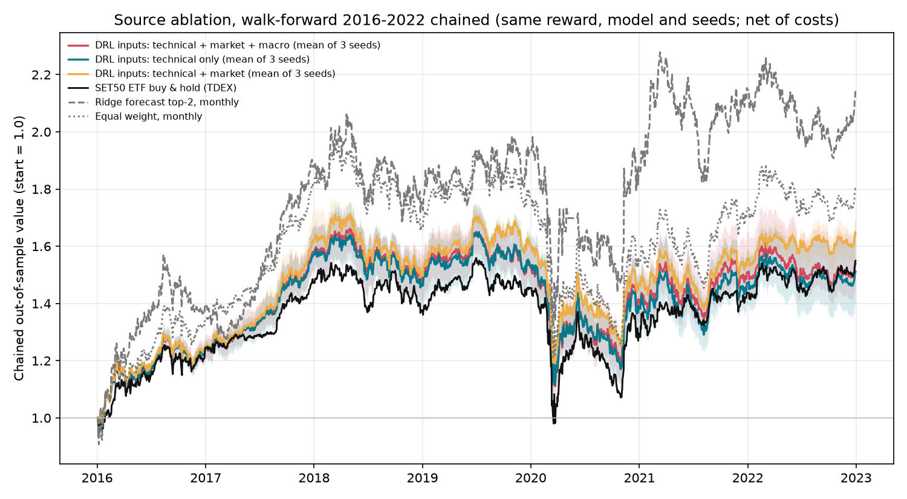

# Data-Source Ablation for the Long-Term DRL Agent (Milestones M4/M6/M7, RQ2/RQ3)

Date: 2026-11-06
Evidence tier: **exploratory**. Yahoo data, the five starter stocks, validation years only.
Outputs: `results/source_ablation_20261106/` and `results/source_ablation_combined_20261106/` (ignored by git)

## Question

Does adding more data sources improve the agent out of sample (RQ2), and which source matters most (RQ3)? Everything except the inputs is held fixed:

- the plan reward and the shared per-asset LSTM model;
- weekly decisions and self-financing accounting with 0.20% cost per side;
- PPO with 100k timesteps;
- the same seven walk-forward years (2016–2022) and the same seeds (42–44).

| Arm | Inputs | Features |
| --- | --- | ---: |
| Technical only | Returns, volatility, moving-average ratios, RSI, MACD, Bollinger, ATR, volume ratio | 11 |
| + Market | Technical + SET50 ETF context (1/5/20-day returns, 20-day volatility, moving-average ratio) | 16 |
| + Market + macro | + daily macro proxies: USD/THB, Brent, gold (5/20-day returns), US 10-year yield (1-day change, 20-day return) | 24 |

The "+ Market" arm is `plan_main_weekly_lstm` from the [seven-year walk-forward](walk_forward_reward_20261106.md), restricted to the same three seeds. The macro proxies are merged backward-only onto Thai trading dates, and the environment adds a further one-session lag.

## Results (7 validation years × 3 seeds per arm)

| Inputs | Mean annual return | vs SET50 ETF | Years beating ETF | Worst year vs ETF | Mean max drawdown | Costs per year | Seed s.d. |
| --- | ---: | ---: | ---: | ---: | ---: | ---: | ---: |
| Technical only | 6.8% | −0.3% | 3/7 | −5.4% | −11.9% | 0.8% | 2.9% |
| **+ Market** | **8.2%** | **+1.1%** | **4/7** | −5.6% | **−11.1%** | 0.8% | 2.5% |
| + Market + macro | 7.1% | −0.1% | 3/7 | −5.9% | −11.8% | 0.9% | 2.1% |
| SET50 ETF buy and hold | 7.1% | — | — | — | −11.3% | 0.0% | — |
| Equal weight, monthly | 10.1% | +3.0% | 4/7 | −4.0% | −13.9% | 0.3% | — |

Chained over 2016–2022, 1.00 grows to:

- 1.51 for technical only
- **1.65 for + market**
- 1.54 for + market + macro
- 1.55 for the SET50 ETF
- 1.80 for monthly equal weight



### Head-to-head significance

Paired stationary block bootstrap on chained daily returns, seed-mean curves, 2,000 resamples:

| Comparison | Sharpe difference | 95% CI | One-sided p (not better) |
| --- | ---: | --- | ---: |
| + Market vs technical only | +0.10 | (−0.002, +0.21) | 0.03 |
| + Market + macro vs technical only | +0.02 | (−0.06, +0.11) | 0.31 |
| + Market + macro vs + market | −0.08 | (−0.20, +0.05) | 0.88 |

### What the agent reads (permutation attribution, 21 models × 3 repeats)

| Group in the + market + macro agent | Change in portfolio weights | Change in annual return | Change in Sharpe |
| --- | ---: | ---: | ---: |
| Technical (11) | 5.5% | −0.21% | −0.010 |
| Macro (8) | 2.9% | −0.15% | −0.015 |
| Market (5) | 1.9% | −0.25% | −0.012 |

## Findings

1. **Market context is the one source with (borderline) evidence of value.** Adding the SET50 ETF features raised the mean annual return by 1.4 points and the Sharpe by 0.10. The one-sided p is 0.03, but the 95% interval touches zero and three comparisons were made, so this is suggestive, not conclusive.
2. **The daily macro proxies did not help.** The agent does read them (they move its weights by 2.9%, more than the market features), but destroying them barely changes results, and adding them gave back the market-context gain. These proxies are noisy daily series, not the official, point-in-time releases the plan calls for.
3. **More inputs did not mean better decisions.** This fits the walk-forward attribution: the long-term agent behaves close to a stable allocation and uses its inputs lightly. Richer sources are only likely to matter once the universe is broad enough for cross-sectional signals (M3) and the inputs are informative (fundamentals, news, investor flow, official macro).

## What is still missing for RQ2/RQ3

- The plan's full cumulative ablation (price → technical → index → macro → fundamentals → sentiment → flow) needs historical news, investor-flow and fundamentals data. The importers and feature builders exist (`score_news.py`, `ingest_investor_flow.py`, `fundamental_flags.py`); the data does not yet.
- The official BOT policy rate (`src/features/policy_rate_context.py`, via `data.policy_rate`) is ready to add as a point-in-time macro arm.
- Three seeds per arm and five survivor stocks are small. Repeat on BistKA with more seeds and the 126-ticker universe.

## Reproduce

```bash
CONFIG=config/source_ablation_experiment.yaml VARIANTS="src_technical src_technical_market_macro" SEEDS="42 43 44" \
  PYTHON=python scripts/run_walk_forward_reward.sh results/source_ablation_20261106 5 100000
python -m scripts.aggregate_walk_forward_reward --run-dir results/source_ablation_20261106 \
  --extra-run-dirs results/walk_forward_reward_20261106 \
  --variants src_technical plan_main_weekly_lstm src_technical_market_macro --seeds 42 43 44 --n-trials 3 \
  --output-dir results/source_ablation_combined_20261106 \
  --labels "src_technical=DRL inputs: technical only" "plan_main_weekly_lstm=DRL inputs: technical + market" \
           "src_technical_market_macro=DRL inputs: technical + market + macro"
python -m scripts.feature_group_attribution --config config/source_ablation_experiment.yaml \
  --run-dir results/source_ablation_20261106 --variant src_technical_market_macro
```

Operational note: two launchers shared this run directory, and three macro-arm tasks (2021 seed 44; 2022 seeds 42 and 43) were trained twice. Each saved output is one complete run of the same seed and code. The launcher now takes an atomic per-task lock, so concurrent launchers can no longer duplicate work.
