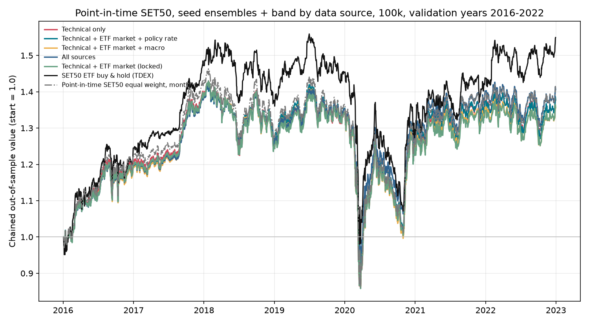

# Data-Source Ablation of the Locked Point-in-Time Design, and a Retrain on BistKA (RQ2/RQ3)

Date: 2026-11-27
Status: **done, validation years 2016–2022 only.** The locked design and its test-year and holdout results are unchanged; this is a check made after them, not a new selection.
Run: BistKA job `4528` (147 tasks, 2026-11-26 23:11 to 2026-11-27 13:12; [HPC log](../hpc/hpc_sync_status.md)). Config `config/pit_source_ablation_cashcap.yaml` (commit `f1f440a`); pool `slurm/pools/bistka_20261126.tasks`.

## Summary

- **Question (RQ2/RQ3):** do the extra data sources help the locked design, and which one matters? Four arms change only the market-level inputs of the locked design. Everything else is held fixed: the 30-session window per member, the shared LSTMs, the shared-weight actor, sticky slots, the 20% cash cap, the plan reward, weekly decisions, 0.20% cost per side, 100k timesteps, seeds 42–46, and folds 2016–2022.
- **No source helps measurably.** Compared on one platform against technical inputs only, the Sharpe differences of the single models are +0.001 for the SET50 ETF inputs (the locked design), +0.009 for the policy rate, −0.011 for the macro proxies and +0.019 for all of them. None is significant.
- **The all-sources ensemble is ahead, but not reliably.** With the band it made 5.5% a year (Sharpe 0.41), the best of the ten designs and level with equal weight (5.6%, 0.38). Its Sharpe is significantly above the locked ensemble's (+0.051, +0.002 to +0.089), which trained on the Mac. Against the technical-only ensemble from the same BistKA run the gap is +0.038 (−0.023 to +0.085), not significant. It is also one of eight new designs, and its single models are not ahead. The lead comes from cash: 12 of its 35 models held more than 15% cash over their year, against 3 of 35 for the locked design. In 2020 three of its five seeds sat near the cap, and the ensemble lost 6.4% against 8.7% for the locked ensemble.
- **The earlier policy-rate shortfall is gone.** Without the cash cap and with three seeds (2026-11-11), adding the policy rate lowered the ensemble's Sharpe significantly (−0.06). With the cap and five seeds, the policy-rate ensemble is level with the technical-only ensemble (+0.004) and the locked ensemble (+0.017). This supports the earlier diagnosis that the shortfall came from cash that depended on the seed, which the cap now limits.
- **Every design stays close to equal weight.** Daily returns correlate 0.994–0.998 with equal weight. The models spread across 43–44 of the 44.5 members tradable on an average day, and no member's weight goes above 3%. With so little tilt, inputs can change little except cash.
- **Decision-7 still selects equal weight.** No design scores above zero. The locked ensemble remains the best (−0.16 points a year), then the macro ensemble (−0.20) and the all-sources ensemble (−0.41).
- **The locked design gives the same result on BistKA.** Retrained with seed 42 on BistKA, it made 4.8% a year (Sharpe 0.347) against 5.0% (0.351) on the Mac. The trained weights differ from the first update, so this is not a byte-level match. The gap between platforms (0.6 points a fold on average) is about half the gap between two seeds on the Mac (1.1 points).

## The arms

| Arm | Market-level inputs | Inputs per member | Observation size |
| --- | --- | ---: | ---: |
| Technical only | none | 12 | 18,051 |
| Technical + ETF market (locked) | SET50 ETF: 1/5/20-day returns, 20-day volatility, moving-average ratio | 17 | 25,551 |
| + policy rate | ETF market + BOT policy rate, its 1-year change, last change in basis points, years since the last change, last dissent share | 22 | 33,051 |
| + macro | ETF market + USD/THB, Brent and gold 5/20-day returns, US 10-year yield 1-day change and 20-day return | 25 | 37,551 |
| All sources | ETF market + policy rate + macro | 30 | 45,051 |

The policy-rate and macro inputs are the same columns as the 2026-11-11 arms (`config/pit_walk_forward_policy_rate.yaml`, `config/pit_walk_forward_macro.yaml`). They are lagged to their release and a further session by the environment. `tests/test_pit_source_ablation_config.py` checks that each arm equals the locked variant except for these inputs. The locked design's results are its five-seed run of 2026-11-25 on the Mac (`pit_walk_forward_cash_cap_100k_5seeds_20261125`); all four arms trained on BistKA.

## Results (validation years 2016–2022, 100k timesteps, 5 seeds, 0.20% cost per side)

| Policy | 2016 | 2017 | 2018 | 2019 | 2020 | 2021 | 2022 | Mean a year | Chained | Sharpe | Mean max drawdown |
| --- | ---: | ---: | ---: | ---: | ---: | ---: | ---: | ---: | ---: | ---: | ---: |
| All sources, ensemble + band | 19.7% | 15.6% | −8.7% | 7.2% | −6.4% | 10.7% | 0.3% | **5.5%** | 1.406 | **0.41** | −11.4% |
| + policy rate, ensemble + band | 19.6% | 15.8% | −8.1% | 6.5% | −8.2% | 10.6% | 0.3% | 5.2% | 1.378 | 0.38 | −12.0% |
| Technical only, ensemble + band | 20.8% | 15.3% | −9.9% | 6.7% | −7.7% | 11.4% | 0.0% | 5.2% | 1.377 | 0.37 | −12.2% |
| + macro, ensemble + band | 19.1% | 16.3% | −9.1% | 6.7% | −8.5% | 10.3% | −0.1% | 5.0% | 1.355 | 0.36 | −12.1% |
| Technical + ETF market (locked), ensemble + band | 19.9% | 15.8% | −10.0% | 7.4% | −8.7% | 10.0% | 0.7% | 5.0% | 1.357 | 0.36 | −12.2% |
| All sources, single models (mean of 5 seeds) | 18.3% | 14.2% | −9.5% | 5.8% | −6.5% | 10.1% | −0.5% | 4.6% | 1.325 | 0.35 | −11.7% |
| + policy rate, single models | 19.7% | 14.1% | −9.3% | 5.8% | −8.1% | 10.3% | −0.2% | 4.6% | 1.327 | 0.34 | −12.2% |
| Technical + ETF market (locked), single models | 19.6% | 14.8% | −10.3% | 6.0% | −7.5% | 9.6% | −0.2% | 4.6% | 1.319 | 0.33 | −12.5% |
| Technical only, single models | 20.0% | 14.8% | −10.2% | 5.4% | −8.0% | 10.2% | −0.4% | 4.5% | 1.316 | 0.33 | −12.4% |
| + macro, single models | 19.1% | 15.2% | −9.5% | 6.2% | −8.9% | 9.0% | −0.4% | 4.4% | 1.303 | 0.32 | −12.5% |
| Equal weight, monthly | 22.2% | 16.5% | −10.0% | 6.5% | −8.5% | 11.9% | 0.7% | 5.6% | 1.407 | 0.38 | −12.7% |
| SET50 ETF, buy and hold | 24.5% | 18.2% | −6.5% | 5.7% | −11.8% | 12.1% | 7.8% | 7.1% | 1.549 | 0.50 | −11.2% |

"Chained" is the value of 1 baht over the seven years (for single models, the mean of the five seeds' chained curves).



| | Gross return a year | Cost drag a year | Turnover a year after entry | Average cash | Models above 15% cash | Seed spread | Decision-7 score | Years ahead of equal weight |
| --- | ---: | ---: | ---: | ---: | ---: | ---: | ---: | ---: |
| Technical only, single | 5.7% | 1.15 pts | 4.6× | 6.0% | 5 of 35 | 0.85 pts | −1.19 | 1 |
| Technical + ETF market (locked), single | 5.4% | 0.88 pts | 3.3× | 5.1% | 3 of 35 | 0.93 pts | −0.96 | 1 |
| + policy rate, single | 5.6% | 0.94 pts | 3.6× | 6.6% | 7 of 35 | 0.96 pts | −0.90 | 2 |
| + macro, single | 5.4% | 1.01 pts | 4.0× | 5.2% | 4 of 35 | 0.95 pts | −1.12 | 1 |
| All sources, single | 5.6% | 1.02 pts | 4.0× | 9.5% | 12 of 35 | 1.15 pts | −1.22 | 2 |
| Technical only, ensemble + band | 5.6% | 0.40 pts | 1.0× | 5.7% | | | −0.48 | 3 |
| Technical + ETF market (locked), ensemble + band | 5.3% | 0.32 pts | 0.6× | 5.4% | | | **−0.16** | 1 |
| + policy rate, ensemble + band | 5.6% | 0.36 pts | 0.8× | 6.8% | | | −0.42 | 2 |
| + macro, ensemble + band | 5.3% | 0.35 pts | 0.8× | 5.2% | | | −0.20 | 3 |
| All sources, ensemble + band | 5.8% | 0.31 pts | 0.6× | 9.1% | | | −0.41 | 3 |
| Equal weight, monthly | 6.0% | 0.40 pts | 0.9× | 0.7% | | | 0 | |

The seed spread is the standard deviation of a fold's return across the five seeds. The decision-7 score is the median over years of the annualized log return above equal weight, in points a year (`scripts/rank_final_candidates.py`).

### Sharpe differences

Block bootstrap on 1,699 chained daily returns; 95% intervals; "significant" means the interval excludes zero.

| Comparison | Difference | 95% interval | Significant |
| --- | ---: | --- | --- |
| *Same platform (BistKA), single models against technical only* | | | |
| + policy rate | +0.009 | −0.027 to +0.048 | no |
| + macro | −0.011 | −0.051 to +0.033 | no |
| All sources | +0.019 | −0.027 to +0.062 | no |
| *Same platform, ensembles + band against technical only* | | | |
| + policy rate | +0.004 | −0.046 to +0.059 | no |
| + macro | −0.014 | −0.061 to +0.027 | no |
| All sources | +0.038 | −0.023 to +0.085 | no |
| *Against the locked design (Mac)* | | | |
| Technical only, single − locked single (the ETF market inputs removed) | −0.001 | −0.028 to +0.028 | no |
| All sources, single − locked single | +0.018 | −0.018 to +0.052 | no |
| Technical only, ensemble − locked ensemble | +0.013 | −0.021 to +0.048 | no |
| + policy rate, ensemble − locked ensemble | +0.017 | −0.031 to +0.065 | no |
| + macro, ensemble − locked ensemble | −0.001 | −0.046 to +0.038 | no |
| All sources, ensemble − locked ensemble | +0.051 | +0.002 to +0.089 | yes (better) |
| *Against equal weight and the ETF* | | | |
| All sources, ensemble − equal weight | +0.029 | −0.021 to +0.071 | no |
| + policy rate, ensemble − equal weight | −0.005 | −0.045 to +0.039 | no |
| Technical only, ensemble − equal weight | −0.009 | −0.045 to +0.031 | no |
| + macro, ensemble − equal weight | −0.023 | −0.068 to +0.017 | no |
| Locked ensemble − equal weight | −0.022 | −0.054 to +0.016 | no |
| All sources, single − equal weight | −0.031 | −0.084 to +0.005 | no |
| + policy rate, single − equal weight | −0.042 | −0.084 to −0.009 | yes (worse) |
| Technical only, single − equal weight | −0.050 | −0.095 to −0.018 | yes (worse) |
| + macro, single − equal weight | −0.061 | −0.108 to −0.024 | yes (worse) |
| All sources, ensemble − ETF | −0.088 | −0.349 to +0.140 | no |

Deflated Sharpe ratios, counting 34 designs tried on these validation years (the earlier 26 and these eight): 0.15 for the all-sources ensemble, 0.13 for equal weight and 0.21 for the ETF.

## Reading the result

- **No source adds measurable value on this universe.** Inside the BistKA run, where training differs only in the inputs, every source moves the Sharpe ratio by less than 0.04, and every interval includes zero. That holds for the SET50 ETF inputs too: the locked design is level with technical inputs alone. On the five starter stocks (2026-11-06) the same ETF inputs raised the Sharpe by 0.10 (one-sided p = 0.03); that gain does not carry over to the SET50.
- **Why the all-sources ensemble is ahead.** Its edge is in the two falling years. In 2020 it lost 6.4% against 8.7% for the locked ensemble and 8.5% for equal weight; in 2018, 8.7% against 10.0% for both. In those years it held 15% and 11% cash, against 5% and 3% for the locked ensemble. But it also held 11% cash in 2016, a rising year, and trailed equal weight by 2.5 points there. So the extra cash looks like a higher level of cash rather than timing, and seven years cannot tell the two apart. It is also the best of eight new designs, and the comparison against the locked ensemble mixes platforms. The comparison on one platform (+0.038) is not significant. It is a lead to test on new years, not a finding.
- **The policy rate no longer hurts.** The earlier arms (no cash cap, three seeds) found that the policy-rate inputs cut the ensemble's return from 5.5% to 4.5% a year, through cash that differed by seed. Under the cap, cash stays at or below 20% at each decision, and the policy-rate ensemble makes 5.2%, level with technical inputs alone.
- **Cash above the cap.** The cap applies at each weekly decision. When a member leaves the SET50, the environment sells it at once and holds the proceeds until the next decision, so cash can briefly exceed 20%. That happened in 43 of the 140 models here (at most 33%, on 5 July 2017 after a 13% forced sale) and in 8 of the locked design's 35 (at most 32%).
- **What this means for the title.** The extension adds real point-in-time macro sources (the BOT policy rate and daily macro proxies) to price and market data, and tests them under the same protocol. The models read them (in the 2026-11-11 attribution, lightly for the policy rate and heavily for the macro proxies), but they do not improve long-term profit after costs on these years.

## The retrain on BistKA

Seven tasks retrained the locked design with seed 42 on every fold on BistKA (Python 3.12, pandas 3.0, Linux), to compare with the Mac's models (Python 3.11, macOS) of 2026-11-19. `scripts/compare_model_runs.py` compares the two, fold by fold:

| Fold | Mac final value | BistKA final value | Gap | Largest daily value gap | Largest weight gap | Average daily L1 gap in holdings |
| --- | ---: | ---: | ---: | ---: | ---: | ---: |
| 2016 | 1.2039 | 1.2031 | −0.08 pts | 0.4% | 1.0 pts | 7.6% |
| 2017 | 1.1589 | 1.1533 | −0.56 pts | 0.5% | 1.1 pts | 5.1% |
| 2018 | 0.8973 | 0.9097 | +1.24 pts | 2.1% | 1.0 pts | 16.2% |
| 2019 | 1.0557 | 1.0587 | +0.30 pts | 1.5% | 3.8 pts | 14.3% |
| 2020 | 0.9353 | 0.9264 | −0.89 pts | 1.0% | 0.7 pts | 5.0% |
| 2021 | 1.0988 | 1.0865 | −1.23 pts | 1.3% | 0.9 pts | 14.8% |
| 2022 | 0.9975 | 0.9968 | −0.06 pts | 0.3% | 1.1 pts | 7.4% |

- **Over the seven years:** 4.8% a year on BistKA against 5.0% on the Mac; chained 1.341 against 1.355; Sharpe 0.347 against 0.351.
- **Not a byte-level match.** The curves differ from the first session, and the trained weights differ by 38–57% of their norm. The same seed and code give a different model on different hardware and library versions, as expected for floating-point training.
- **Smaller than a seed change.** The mean gap in a fold's final value is 0.6 points; between two Mac seeds it is 1.1 points. The holdings gap (average daily L1 distance 10%) is also below the gap between seeds 42 and 43 on the Mac (15%). Because every model stays near equal weight, different trained weights give similar portfolios.
- **Inference does carry over.** The Mac replayed all 140 BistKA models of the source arms, and their seed ensembles, to within 4 × 10⁻⁸ of the curves BistKA saved.
- **For the report:** results from the two machines can be pooled as further seeds, but a retrain on another machine reproduces the result, not the files. Exact reruns need the same platform; the evidence for the Mac's own determinism is the byte-identical rerun of 2026-11-27 ([architecture ablation](architecture_ablation_20261127.md#compute-and-one-task-rerun)).

## Compute

- **BistKA job 4528:** 14 h 01 min on 32 CPUs and 80 GB (peak about 40 GiB), 561 SHr at 40 SHr an hour; 6,503 SHr are left. A two-minute smoke stage at 3,000 steps came first.
- **Per model:** about 10,100–10,700 seconds (2.8–3.0 hours) with 32 tasks at once, against about 2,190 seconds on the Mac with three workers. The tasks of the last wave, with CPUs free, took about 1.5–1.8 hours.
- **On the Mac:** the four seed ensembles took under a minute each; the aggregation and diagnostics a few minutes.

## Files

- `~/drl_runs/pit_source_ablation_cashcap_bistka_20261126/`: the 140 models of the four arms, one folder per fold and seed (copied from BistKA, SHA-256 checked).
- `~/drl_runs/pit_cash_cap_100k_replication_bistka_20261126/`: the seven retrained locked models, with `comparison_with_*.csv` and `cross_platform_detail.csv`.
- `~/drl_runs/pit_src_<arm>_ensemble_20261127/`: each arm's seed ensemble with the band, replay check and diagnostics.
- `~/drl_runs/pit_walk_forward_combined_source_ablation_20261127/`: summary, fold returns, metrics, significance against equal weight, the ETF, the locked design and technical only, diagnostics (`diagnostics_all_designs.csv`), the figure of all ten designs, `ensembles_only/` and `decision7/`.
- `config/source_ablation_candidates_20261127.yaml`: decision-7 inputs.

## Commands

```bash
R=~/drl_runs; V=pit_plan_weekly_lstm_shared_cashcap; S=$R/pit_source_ablation_cashcap_bistka_20261126
O=$R/pit_walk_forward_combined_source_ablation_20261127
# On BistKA (job 4528)
sbatch --mem=80G --time=2-00:00:00 --job-name=drl_pool_src \
  --export=ALL,PROJECT_DIR=$PWD,POOL=slurm/pools/bistka_20261126.tasks slurm/walk_forward_pool.sbatch
# On the Mac, after copying both result folders
for a in technical policy macro all; do
  python -m scripts.evaluate_pit_seed_ensemble --config config/pit_source_ablation_cashcap.yaml --source-run $S \
    --variant pit_cashcap_src_$a --seeds 42 43 44 45 46 --output-dir $R/pit_src_${a}_ensemble_20261127 --band 0.005 --modes ensemble_band
  python -m scripts.walk_forward_agent_diagnostics --run-dir $R/pit_src_${a}_ensemble_20261127 \
    --variant pit_cashcap_src_${a}_ensemble_band --prefix diagnostics_ensemble_band
  python -m scripts.walk_forward_agent_diagnostics --run-dir $S --variant pit_cashcap_src_$a --output-dir $O --prefix diagnostics_single_$a
done
python -m scripts.aggregate_walk_forward_reward --run-dir $S \
  --extra-run-dirs $R/pit_src_{technical,policy,macro,all}_ensemble_20261127 \
    $R/pit_walk_forward_cash_cap_100k_5seeds_20261125 $R/pit_cash_cap_ensemble_100k_5seeds_20261125 \
  --variants pit_cashcap_src_technical pit_cashcap_src_policy pit_cashcap_src_macro pit_cashcap_src_all $V \
  --seeds 42 43 44 45 46 --n-trials 34 --output-dir $O \
  --references pit_equal_weight_monthly ${V}_ensemble_band $V pit_cashcap_src_technical pit_cashcap_src_technical_ensemble_band
python -m scripts.rank_final_candidates --candidates config/source_ablation_candidates_20261127.yaml --base $R --output-dir $O/decision7
python -m scripts.compare_model_runs --left $R/pit_walk_forward_cash_cap_100k_5seeds_20261125 \
  --right $R/pit_cash_cap_100k_replication_bistka_20261126 --variant $V --seeds 42
```

The aggregation was run with `--title` and `--labels` for the figures (see `~/drl_runs/logs_src_20261127/`); the ensembles-only figure is the same command over the five ensemble folders with `--variants` given no names.
