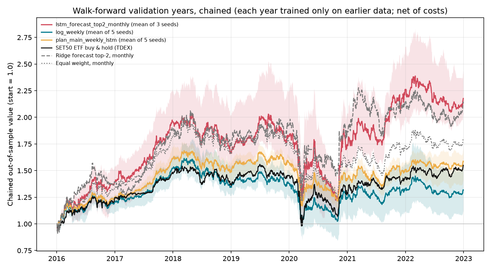

# Seven-Year Walk-Forward Test of the Long-Term DRL Designs (Milestones M6/M7, RQ1/RQ5)

Date: 2026-11-06
Evidence tier: **exploratory**. Yahoo data, the five starter stocks, validation years only.
Outputs: `results/walk_forward_reward_20261106/` (ignored by git; reproduce with the commands below)

## Question

The single-window experiment ([`long_term_reward_experiment_20261106.md`](long_term_reward_experiment_20261106.md)) carried two designs forward:

- `plan_main_weekly_lstm`: plan reward, weekly decisions, shared per-asset LSTM model;
- `log_weekly`: log-wealth reward, weekly decisions, MLP.

Do they hold up year after year? Do they beat the market and simple supervised alternatives?

## Design

| Item | Setting |
| --- | --- |
| Folds | 7 expanding folds. Each trains on 2012-01-04 → 31 Dec of year *Y−1* and validates on year *Y* (2016–2022). The 2022 fold ends on 2022-12-30, the last session before the test years. |
| Not read | 2023–2024 test years and every sealed 2025+ holdout |
| Seeds | DRL designs 42–46 (5 per fold, 70 trained models); LSTM forecaster 42–44 |
| Training | PPO, 100k timesteps, train-only observation normalization, random 2-year training episodes |
| Costs | 0.15% + 0.05% slippage per side for every policy (covers the published ≈0.176% Thai explicit cost; see `src/envs/thai_costs.py`) |
| Accounting | Self-financing for every policy (security-only turnover, weights drift) |
| Baselines | SET50 ETF (TDEX) buy and hold; equal weight (buy and hold, monthly); ridge and LSTM 21-day forecasters, each fitted on that fold's training dates only and buying its top 2 forecasts monthly |

## Results

### Across the seven validation years

| Strategy | Mean annual return | Mean excess vs SET50 ETF | Years beating ETF | Worst year vs ETF | Mean max drawdown | Costs per year | Seed s.d. |
| --- | ---: | ---: | ---: | ---: | ---: | ---: | ---: |
| LSTM forecast, top 2 monthly | **13.8%** | **+6.7%** | 5/7 | −11.1% | −17.0% | 2.6% | 7.4% |
| Ridge forecast, top 2 monthly | 12.8% | +5.6% | 5/7 | −7.8% | −16.8% | 2.7% | — |
| Equal weight, monthly | 10.1% | +3.0% | 4/7 | −4.0% | −13.9% | 0.3% | — |
| Equal weight, buy and hold | 9.8% | +2.6% | 3/7 | −3.7% | −14.0% | 0.2% | — |
| **DRL: plan reward + LSTM model** | 7.7% | +0.5% | 3/7 | −5.6% | **−11.1%** | 0.8% | 2.6% |
| SET50 ETF buy and hold | 7.1% | — | — | — | −11.3% | 0.0% | — |
| DRL: log reward, MLP | 5.0% | −2.2% | 2/7 | −8.8% | −14.2% | 5.3% | 6.5% |

Chained over 2016–2022 (each year uses a model trained only on earlier years), 1.00 grows to:

- 2.18 for the LSTM forecast
- 2.15 for the ridge forecast
- 1.80 for monthly equal weight
- **1.59 for the DRL LSTM agent**
- 1.55 for the SET50 ETF
- 1.32 for the DRL MLP agent



### Year by year (seed-averaged annual return)

| Year | LSTM forecast | Ridge forecast | Equal weight (monthly) | DRL LSTM | SET50 ETF | DRL MLP |
| --- | ---: | ---: | ---: | ---: | ---: | ---: |
| 2016 | 39.7% | 39.1% | 34.7% | 25.1% | 24.5% | 20.7% |
| 2017 | 39.7% | 35.0% | 35.3% | 29.0% | 18.2% | 26.3% |
| 2018 | −13.9% | −6.6% | −8.0% | −7.2% | −6.5% | −11.3% |
| 2019 | 8.1% | 9.9% | 5.7% | 5.0% | 5.7% | 2.2% |
| 2020 | −4.2% | −3.4% | −12.8% | −9.8% | −11.8% | −10.1% |
| 2021 | 30.6% | 15.3% | 12.3% | 6.4% | 12.1% | 7.7% |
| 2022 | −3.3% | 0.0% | 3.9% | 4.9% | 7.8% | −0.9% |

### Statistical significance

These use chained daily out-of-sample returns, the seed-mean curve per design, and a stationary block bootstrap. The deflated Sharpe counts the 6 designs tried in the reward experiment.

| Strategy | Sharpe (95% CI) | Probabilistic Sharpe > 0 | Deflated Sharpe | Sharpe difference vs SET50 ETF (95% CI) | vs equal weight (95% CI) |
| --- | --- | ---: | ---: | --- | --- |
| LSTM forecast | 0.64 (−0.11, 1.38) | 0.96 | 0.65 | +0.15 (−0.29, 0.51) | +0.07 (−0.25, 0.35) |
| Ridge forecast | 0.62 (−0.07, 1.27) | 0.95 | 0.62 | +0.12 (−0.45, 0.58) | +0.04 (−0.40, 0.42) |
| Equal weight, monthly | 0.58 (−0.18, 1.36) | 0.93 | 0.58 | +0.08 (−0.25, 0.39) | — |
| DRL: plan reward + LSTM | 0.55 (−0.20, 1.32) | 0.92 | 0.55 | +0.05 (−0.29, 0.36) | −0.03 (−0.13, 0.07) |
| SET50 ETF | 0.50 (−0.27, 1.33) | 0.90 | 0.50 | — | −0.08 (−0.39, 0.25) |
| DRL: log reward, MLP | 0.34 (−0.40, 1.10) | 0.81 | 0.34 | −0.16 (−0.53, 0.16) | **−0.24 (−0.41, −0.10)** |

The only difference whose confidence interval excludes zero is that the MLP agent is worse than monthly equal weight. Even seven years cannot separate the DRL LSTM agent, the ETF, equal weight and the forecasters from each other. A deflated Sharpe of 0.55 for the DRL LSTM agent means its edge over six unskilled designs is close to a coin flip.

### Which inputs do the agents use? (`scripts/feature_group_attribution.py`)

Each feature group was shuffled in time, 3 repeats, on all 35 models per design:

| Design | Group (features) | Change in portfolio weights | Change in annual return | Change in Sharpe |
| --- | --- | ---: | ---: | ---: |
| DRL LSTM | technical (11) | 5.8% | −0.02% | −0.006 |
| DRL LSTM | market (5) | 2.5% | −0.04% | −0.001 |
| DRL MLP | technical (11) | 26.7% | −2.1% | −0.145 |
| DRL MLP | market (5) | 19.2% | −2.2% | −0.146 |

- **The LSTM agent behaves close to a stable allocation.** Shuffling either source barely moves its weights or results, which explains its low turnover and ETF-like drawdown.
- **The MLP agent reacts strongly to both sources**, and destroying either costs about 2% a year. It does extract information, but its trading costs (5.3% a year) exceed what that information earns.

## Findings

1. **RQ1/RQ5: the long-term DRL design is robust but not superior.** Over seven years it roughly matched the SET50 ETF (+0.5% a year, 3 of 7 years ahead) with the lowest drawdown of any strategy. It was the most seed-stable DRL design (s.d. 2.6 points against 6.5 for the MLP).
2. **Within this five-stock universe, simple alternatives did better.** Equal weight beat the DRL agent by about 2.5% a year, and the supervised forecasters by 5–6%. None of these gaps is statistically significant, so the honest conclusion is "no evidence that DRL adds value here", not "DRL loses".
3. **Some of the baselines' advantage is survivorship bias.** The five stocks are today's mega-caps, chosen with hindsight, so even buying them equally beats the market index on average (+2.6% to +3.0% a year). Any strategy confined to them inherits that tailwind. The 126-ticker point-in-time universe (M3) is needed before claiming anything about Thai markets broadly.
4. **Model architecture matters more than reward fine-tuning.** Under the same reward, the shared per-asset LSTM model beat the flat MLP by 2.7% a year with much less turnover. That agrees with the single-window experiment.

## Limitations

- Exploratory data: Yahoo prices for five surviving mega-caps, with the TDEX ETF in place of the SET index.
- PPO only, 100k timesteps, one hyperparameter setting, no tuning.
- Validation years only; the 2023–2024 test years and the holdouts stay unread until the protocol is locked.
- The seven yearly folds overlap in training data; per-fold results are not independent samples.

## Reproduce

```bash
PYTHON=python scripts/run_walk_forward_reward.sh results/walk_forward_reward_20261106 5 100000
python -m scripts.evaluate_forecast_baselines --config config/long_term_reward_experiment.yaml \
  --run-dir results/walk_forward_reward_20261106 --years 2016 2017 2018 2019 2020 2021 2022
python -m scripts.aggregate_walk_forward_reward --run-dir results/walk_forward_reward_20261106
python -m scripts.feature_group_attribution --config config/long_term_reward_experiment.yaml \
  --run-dir results/walk_forward_reward_20261106 --variant plan_main_weekly_lstm
```

On one CPU core per process, an LSTM-model run takes about 20–30 minutes and an MLP run about 8–12 minutes.
